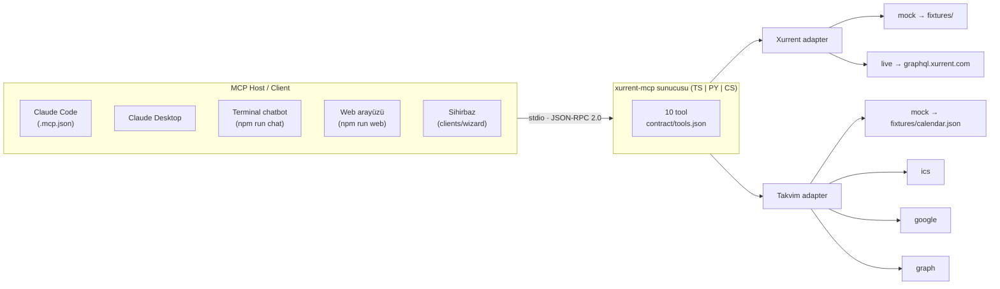

# 00 — Genel bakış

> **Bölüm hedefi:** Bu projenin hangi problemi çözdüğünü, neden MCP kullandığımızı ve
> repoda neyin nerede olduğunu 10 dakikada anlamak.

| ← | Sonraki → |
|---|---|
| [README](../README.md) | [01 — Xurrent API](01-xurrent-api.md) |

---

## Çözülecek problem nedir?

Dört cümlelik bir ister listesi:

1. İlgili kişinin üzerindeki **açık görev ve talepleri** id + açıklama ile listele.
2. Her biri için kullanıcı **süre belirtsin** — başlangıç saati ile, tarih **T** veya **T-1**.
3. Bu girişleri **ilgili kişi ve görev için** Xurrent'a kaydet.
4. Kişinin o günkü **takvimini oku**, her toplantıyı zaman girişi olarak ekle.

Dört cümle. Hepsi masumca duruyor.

Gerçek şu: **2 ve 3 birlikte, Xurrent API'sinde tek bir çağrıyla mümkün değil.** Bu keşif
tüm mimariyi belirledi ve dersin ana konusu bu. Ayrıntısı
[02 — Zaman girişi modeli](02-zaman-girisi-modeli.md)'nde.

---

## Neden MCP? Neden düz bir API istemcisi değil?

Bu işi 300 satır TypeScript ile de yazabilirdik. Yazmadık. Sebep:

**Asıl zorluk API çağrısı yapmak değil — müzakere.**

Kullanıcı şunu yazıyor:

> *"dün 2 saat VPN işine baktım"*

Bu tek cümlede cevaplanması gereken beş soru var:

| Soru | Neden tek atışta cevaplanamaz |
|---|---|
| Hangi ticket? | Request #70301 *ve* Task #4419 aynı derecede benziyor |
| "2 saat" kaç dakika? | Xurrent dakika ister → 120 |
| 120 yazılabilir mi? | `timeIncrement` 30 ise evet, 45 olsaydı hayır |
| "Dün" kabul edilir mi? | T-1 sınırı var; ve seçilen stratejiye göre *karşılanamayabilir* |
| Kim adına? | Varsayılan authenticated user; başkası ise yetki gerekir |

Bu bir **diyalog**, tek atışlık bir istek değil. MCP tam olarak bunu çözer: sen
*yetenekleri* (tool) tanımlarsın, LLM diyaloğu yürütür.

Ve asıl kazanç şu — **bir kez yaz, her yerde kullan**:



Beş farklı istemci, tek sunucu. Chatbot'u yeniden yazmadan Claude Code'a takabiliyoruz;
Claude Code'u kullanmadan kendi chatbot'umuzu çalıştırabiliyoruz. Protokol katmanı bunu
bedava veriyor.

**Karşı argüman da dürüstçe:** MCP sana bir soyutlama vergisi ödetir. JSON Schema yazarsın,
transport kurarsın, elicitation'ı ele alırsın. Tek bir istemciye tek bir entegrasyon
yazacaksan bu vergi pahalıdır. Üç istemci veya üç dil varsa bedavaya gelir.

---

## Dört ister hangi tool'a düşüyor?

| # | İster | Tool | Tür |
|---|---|---|---|
| — | Bağlantı smoke test'i | `xurrent_whoami` | okuma |
| — | Kişiyi e-posta ile bul | `xurrent_find_person` | okuma |
| **1** | Açık görev/talepleri listele | `xurrent_list_open_work` | okuma |
| — | Yazmadan önce kısıtları öğren | `xurrent_get_time_tracking_context` | okuma |
| **2+3** | Süreyi kaydet | `xurrent_create_time_entry` | **yazma** |
| **3** | Toplu kaydet | `xurrent_create_time_entries_bulk` | **yazma** |
| **4a** | Günün takvimini oku | `calendar_list_today` | okuma |
| **4b** | Toplantıları öneriye çevir | `plan_time_entries_from_calendar` | **önizleme** |
| **3 (doğrulama)** | Yazılanı geri oku | `xurrent_list_time_entries` | okuma |
| **2+3 (sohbet)** | LLM'siz host'ta diyaloğu yürüt | `timesheet_wizard` | **sohbet** |

On tool: **5 okuma + 2 yazma + 1 takvim + 1 önizleme + 1 sohbet.**

Dikkat çeken iki tasarım kararı:

- **`xurrent_get_time_tracking_context` bir "ister" değil.** Kimse istemedi. Ama onsuz
  yazma tool'u kör uçuş yapar — `timeIncrement` bilinmeden `timeSpent` seçilemez.
  Bu tool'un varlığı, API keşfinin mimariyi nasıl değiştirdiğinin kanıtı.
- **`plan_time_entries_from_calendar` yapısal olarak yazamaz.** İster #4 "her toplantıyı
  zaman girişi olarak ekle" diyor; biz "her toplantı için bir öneri üret" diye
  implemente ettik. Sebebi [03 — MCP tasarımı](03-mcp-tasarimi.md#dry-run)'nda.

Sözleşmenin kendisi: [`contract/tools.json`](../contract/tools.json). Tool adları,
parametre adları ve çıktı alanları **birebir** oradan gelir; üç sunucu da onu uygular ve
`node scripts/verify-contract.mjs --all` bunu otomatik doğrular.

---

## Repoda ne nerede?

```
contract/tools.json      ← tek gerçek kaynak. 10 tool'un dil-bağımsız sözleşmesi.
contract/protocol.md     ← çift protokol sözleşmesi (2025-11-25 + 2026-07-28)
fixtures/*.json          ← ortak mock veri. Üç dil de AYNI dosyaları okur.
fixtures/README.md       ← göreli tarih sözleşmesi (dayOffset / startLocal)
docs/                    ← bu klasör: anlatım notları
docs/wizard/steps.json   ← sihirbazın ders akışı (16 adım)
servers/typescript/      ┐
servers/python/          ├ üç bağımsız implementasyon, aynı sözleşme
servers/csharp/          ┘
clients/wizard/          ← MCP client sihirbaz, --server ts|py|cs
clients/web/             ← ortak statik web arayüzü
scripts/                 ← verify-contract, gen-ics, google-auth
.mcp.json                ← Claude Code proje-scope MCP yapılandırması
.env.example             ← tüm env değişkenleri ve anlamları
```

**Okuma sırası önerisi:** `contract/tools.json` → `fixtures/README.md` → bu docs klasörü.
Kodu en son oku. Sözleşmeyi anlamadan koda bakmak, kodun *neden* öyle olduğunu göstermez.

---

## Mock mod nedir ve neden varsayılan?

`XURRENT_MODE=mock` ile sunucu hiç internete çıkmaz, token istemez ve
[`fixtures/`](../fixtures/) klasöründen okur. Yazmalar bellekte birikir.

Bu bir "demo kolaylığı" değil, **bilinçli bir öğretim aracı**. Fixture'lar tuzakları
tetiklemek için tasarlandı:

| Fixture ayrıntısı | Öğrettiği tuzak |
|---|---|
| Request 70120 `status: completed` | Kapalı kayıt filtrelenmeli |
| Task 4390 `status: approved` | Task'ta **beş** terminal durum var, sadece `completed` değil |
| Effort class "Eski tarife" `disabled: true` | `EffortClassFilter`'da `disabled` filtresi yok → client-side eleme |
| `timeIncrement: 30` | 45 dakikalık toplantı olduğu gibi yazılamaz |
| Takvimde 8 etkinlik, 5'i gerçek | all-day / free / declined elemesi |
| İki toplantı çakışıyor | `busyMinutes` (225) ≠ `naiveSumMinutes` (255) |

Fixture'larda **mutlak tarih yoktur**; `dayOffset` ile göreli tutulur ve yükleme anında
materyalize edilir. Demo hangi gün çalıştırılırsa çalışsın "dün" hep dündür.
Ayrıntı: [`fixtures/README.md`](../fixtures/README.md).

### Mock modda beklenen sayılar

Üç dil de **birebir** bunları üretmek zorundadır. Sözleşme uyumunun görünür kanıtı:

| Tool | Beklenen |
|---|---|
| `xurrent_list_open_work` | `requests.totalCount = 3`, `tasks.totalCount = 3` |
| `xurrent_get_time_tracking_context` | `timeIncrement = 30`, `effortClasses.length = 3` |
| `calendar_list_today` (bugün) | `rawCount = 8`, `count = 5`, `filteredOut = 3`, `busyMinutes = 225`, `naiveSumMinutes = 255` |
| `plan_time_entries_from_calendar` | `proposals.length = 5` |
| `xurrent_create_time_entry` dry-run, `two_step` | `planned.length = 2` |
| aynısı, `link_first` / `date_first` | `planned.length = 1` |

---

## Bu dersten ne öğreneceksin?

1. **Bir MCP sunucusu nasıl tasarlanır** — tool sınırlarını çizmek, JSON Schema yazmak,
   `annotations` ile istemciye niyet bildirmek.
2. **API keşfinin mimariyi nasıl belirlediği** — "`timeEntryCreate` bir ticket'a
   bağlanamaz" bulgusu üç ayrı strateji doğurdu. Kod yazmadan önce keşfetmenin getirisi.
3. **Sessiz hataların anatomisi** — `member` yerine `assignee`, eksik `view: all`,
   `singleEvents` unutmak. Hepsi *hata vermeden* yanlış sonuç üretir. En kötü hata türü.
4. **Yazma güvenliği** — üç katmanlı dry-run, protokol seviyesinde onay (elicitation),
   fail-closed politika. LLM ikna edilebilir; protokol edilemez.
5. **Gerçek dünyanın dağınıklığı** — Microsoft Graph ile Google Calendar'ın aynı kavramı
   farklı alanlarla ifade etmesi ve normalizasyon katmanının neden zorunlu olduğu.
6. **AI destekli geliştirmede asıl beceri** — kod yazmak değil, **doğru sözleşmeyi tarif
   etmek**. Sözleşme netse implementasyon dili gerçekten bir detaydır; bunu üç dilde
   kanıtlıyoruz.
7. **Bir breaking change'i yaşamak** — MCP'nin `2026-07-28` revizyonu tam olarak bizim
   onay akışımızı kaldırdı. İş mantığı protokolden ayrı olduğu için değişiklik ince bir
   adaptör katmanında kaldı. Ayrıntı: [09 — Protokol geçişi](09-protokol-gecisi.md).

---

## Bölüm haritası

| Bölüm | Konu | Ne zaman oku |
|---|---|---|
| **00 — Genel bakış** (buradasın) | Problem, mimari, repo | İlk |
| [01 — Xurrent API](01-xurrent-api.md) | GraphQL, auth, filtre tuzakları | Okuma tool'larından önce |
| [02 — Zaman girişi modeli](02-zaman-girisi-modeli.md) ★ | İki yol, üç strateji, `timeIncrement` | **Dersin kalbi** |
| [03 — MCP tasarımı](03-mcp-tasarimi.md) | Tool envanteri, dry-run, elicitation | Yazma tool'larından önce |
| [04 — Takvim](04-takvim.md) | Graph vs Google, normalizasyon | İster #4'ten önce |
| [05 — Chatbot](05-chatbot.md) | Sistem promptu, diyalog sözleşmesi | Chatbot'u çalıştırmadan önce |
| [06 — Üç dil karşılaştırma](06-uc-dil-karsilastirma.md) | Aynı sözleşme, üç SDK | Kodu okumadan önce |
| [07 — Sihirbaz](07-sihirbaz.md) | `steps.json`, ders akışı | Dersi vermeden önce |
| [08 — Riskler ve SSS](08-riskler-ve-sss.md) | Doğrulanmalı liste, kurtarma notları | Canlıya bağlanmadan önce |
| [09 — Protokol geçişi](09-protokol-gecisi.md) ★ | `2026-07-28`, MRTR, `requestState`, ölçüm | Breaking change'i anlamak için |
| [10 — Sıfırdan geliştirme](10-sifirdan-gelistirme.md) ★ | Proje nasıl üretildi: 7 faz, kararlar, tuzaklar | Süreci anlamak için |
| [11 — Prompt defteri](11-prompt-defteri.md) | Atölye adımlarının kopyala-yapıştır hâli (ÜRETİLİR) | Atölyeyi kendin yaparken |
| [12 — MCP uyum](12-mcp-uyum.md) | Spec uyum denetimi, MUST/SHOULD, borç defteri | Kendi sunucunu denetlerken |
| [13 — Inspector](13-inspector.md) | Resmî inspector + repo'nun açıklamalı ekranı | Protokolü gözle görmek için |
| [14 — Test ve kalite](14-test-ve-kalite.md) | Altı katmanlı doğrulama piramidi | Test stratejisi için |
| [15 — Güvenilirlik](15-guvenilirlik.md) ★ | Retry, dedup, kaos senaryoları, "kesin mesajlaşma" | Rate limit'e çarpmadan önce |
| [16 — REST ve resmî SDK](16-rest-ve-sdk.md) | İkinci transport, 422 modeli, vendor SDK ölçümü | Transport seçmeden önce |
| [17 — Plugin ve Copilot Studio](17-plugin-ve-copilot.md) | Plugin modeli, konektör, tunnel yürüyüşü | Dış yüzey bağlarken |
| [18 — CLI](18-cli.md) | `xmcp`: ham JSON-RPC istemcisi + TUI sohbet | Terminalden sürmek için |
| [19 — Dağıtım](19-dagitim.md) | IaC taslağı, replika deneyi, açık kararlar | Buluta çıkmadan önce |
| [Demo senaryosu](demo/senaryo.md) | Sunum script'i, süre tahminleri | Sunum sabahı |

**00'dan 19'a yirmi bölüm**, artı demo senaryosu. Sıra bir okuma sırasıdır,
zorunluluk değil — yıldızlılar önceliklidir: **02** dersin kalbi, **09** en güncel
dersi, **10** sürecin kendisi, **15** üretim yoluna çıkmadan önceki son kapı.
