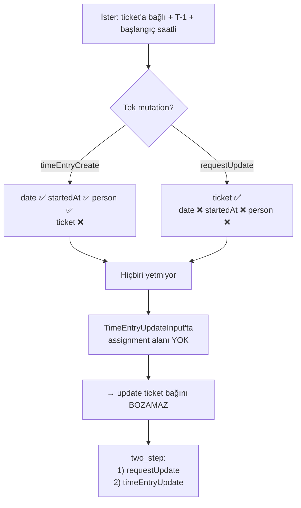
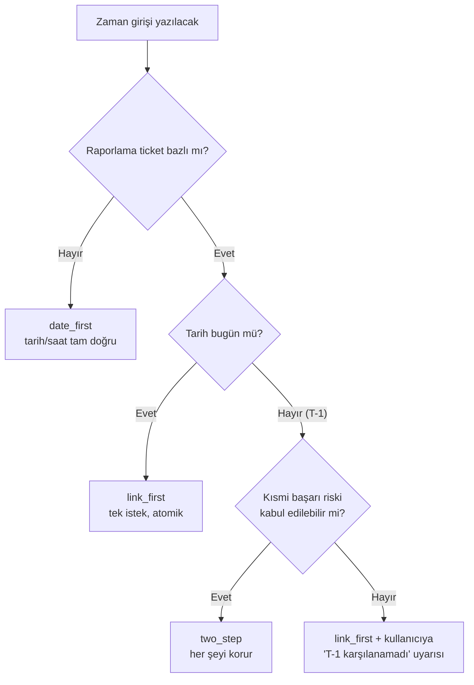

# 02 — Zaman girişi modeli ★

> **Bölüm hedefi:** Xurrent'ta bir zaman girişinin *gerçekte* ne olduğunu, bir ticket'a
> bağlanmanın neden iki farklı yolu olduğunu ve ikisinin de neden tek başına yetmediğini
> anlamak. **Bu dersin kalbi burasıdır.**

| ← Önceki | Sonraki → |
|---|---|
| [01 — Xurrent API](01-xurrent-api.md) | [03 — MCP tasarımı](03-mcp-tasarimi.md) |

---

## Bir zaman girişi neyden oluşur?

Sezgin şöyle der: *bir zaman girişi bir başlangıç ve bir bitiş saatidir.*

Xurrent'ta öyle değil:

```
TimeEntry = date        (hangi GÜN — timesheet bu alana göre gruplanır)
          + startedAt   (başlangıç ANI — sadece metadata)
          + timeSpent   (SÜRE, DAKİKA cinsinden)
```

**Bitiş saati alanı YOKTUR.**

Bu üç sonucu doğurur ve üçü de gerçek koda dokunur:

| Sonuç | Anlamı |
|---|---|
| Kullanıcı "09:00–11:00" derse | `startedAt = 09:00`, `timeSpent = 120` diye **ayrıştırılır** |
| Chatbot asla "bitiş saati kaçtı?" diye sormaz | **"Kaç dakika sürdü?"** diye sorar |
| `startedAt` timesheet gününü belirlemez | Günü belirleyen **yalnızca `date`**'tir |

Son madde ince ve tehlikeli: `startedAt = 2026-08-01T23:30:00+03:00` ve
`date = 2026-08-02` göndermek **geçerlidir.** İki alan birbirini doğrulamaz. Tutarlılık
senin sorumluluğun.

### Birim: DAKİKA. Her zaman.

`timeSpent` **dakikadır.** Saat değil, saniye değil, ondalık saat değil.

Sözleşmede yazılı ([`contract/tools.json`](../contract/tools.json) → `conventions`):

> Kullanıcı "2 saat" derse chatbot **120'ye çevirir ve çevirdiğini söyler.**

"Çevirdiğini söyler" kısmı süs değil. Kullanıcı "1,5 saat" dediğinde 90 mu 150 mi
anlaşıldığını görmeli. Sessiz birim dönüşümü, sessiz veri bozulmasıdır.

---

<a id="createinput"></a>

## `TimeEntryCreateInput` — 17 alan, tam liste

Şema seviyesinde **tek zorunlu alan `timeSpent`**'tir. Geri kalan her şey opsiyoneldir
(ama iş kuralları ek zorunluluk getirir — bkz. `timeAllocationId`).

| # | Alan | Tip | Not |
|---|---|---|---|
| 1 | `timeSpent` | `Int!` | **DAKİKA.** Şema seviyesinde tek zorunlu alan. `timeIncrement`'in katı olmalı. Negatif yalnızca `correction: true` ile. |
| 2 | `date` | `ISO8601Date` | `YYYY-MM-DD`. Timesheet günü **budur**. Boşsa bugün. |
| 3 | `startedAt` | `ISO8601Timestamp` | Başlangıç anı. **Sadece metadata** — günü değiştirmez. |
| 4 | `personId` | `ID` | Boşsa authenticated user. Farklıysa manager / substitute / Account Administrator yetkisi gerekir. |
| 5 | `timeAllocationId` | `ID` | **Yol A'nın hedefi.** Ticket değil, bir "kova". |
| 6 | `effortClassId` | `ID` | Faturalama çarpanını belirler. |
| 7 | `description` | `String` | **Maks. 80 karakter.** |
| 8 | `customerId` | `ID` | Yalnızca Yol A'da anlamlı. |
| 9 | `serviceId` | `ID` | Yalnızca Yol A'da anlamlı. |
| 10 | `organizationId` | `ID` | Kişinin **kendi** organizasyonu (müşteri değil). |
| 11 | `teamId` | `ID` | |
| 12 | `noteId` | `ID` | Mevcut bir not kaydına referans. **Serbest metin değil.** |
| 13 | `correction` | `Boolean` | Negatif `timeSpent` için zorunlu. |
| 14 | `deleted` | `Boolean` | Soft delete. |
| 15 | `source` | `String` | Hangi entegrasyonun yazdığı. `XURRENT_SOURCE` env değeri. |
| 16 | `sourceID` | `String` | **Idempotency anahtarı.** Yeniden denemede çift kayıt oluşmasını engeller. |
| 17 | `clientMutationId` | `String` | GraphQL istek korelasyonu. |

### Ve şimdi — OLMAYAN alanlar

Bu liste, olan alanlardan daha önemli:

```
❌ assignmentId          ❌ requestId        ❌ taskId
❌ projectTaskId         ❌ problemId
❌ note   (String)       ❌ startTime        ❌ serviceInstanceId
```

Sonuç, tek cümlede:

> ## `timeEntryCreate` bir Request veya Task'a **BAĞLANAMAZ.**
> Oluşan kaydın `assignment` değeri **`null`**'dır.

Bu tek cümle bu projenin tüm mimarisini belirledi.

Dikkat: `note` yerine `noteId` olması da ayrı bir tuzak. "Not düşeyim" diyip `note:
"..."` göndermek şema hatası verir; not yazmak için önce bir Note kaydı gerekir.
`description` (80 karakter) ile `note` (uzun metin) farklı şeylerdir.

---

<a id="iki-yol"></a>

## İki yol — ve neden ikisi de yetmez

Bir Request/Task'a zaman yazmanın **tek** yolu, parent kaydın update mutation'ıdır:

```
requestUpdate  ·  taskUpdate  ·  projectTaskUpdate  ·  problemUpdate
```

Dördünün de ortak üçlüsü:

| Alan | Tip | Anlamı |
|---|---|---|
| `timeSpent` | `Int` | **DAKİKA, ARTIMLI** — "eklenen süre", toplam değil |
| `timeSpentEffortClassId` | `ID` | Effort class |
| `timeEntryDescription` | `String` | Oluşacak entry'nin açıklaması |
| `note` | `String` | Ticket'a düşülen not (ayrı) |

Bu yolda `date` **sunucu tarafından "bugün"** atanır, `person` **authenticated user**
olur. İkisi de **kontrol edilemez.**

### Karşılaştırma tablosu

| | **Yol A** — `timeEntryCreate` | **Yol B** — `requestUpdate` / `taskUpdate` / `projectTaskUpdate` / `problemUpdate` |
|---|---|---|
| Ticket'a bağlar mı? | ❌ `assignment = null` | ✅ **tek yol** |
| `date` (T-1) kontrolü | ✅ tam kontrol | ❌ sunucu "bugün" atar |
| `startedAt` (başlangıç saati) | ✅ | ❌ kaydedilmez |
| `personId` (başkası adına) | ✅ | ❌ authenticated user |
| `effortClass` | ✅ `effortClassId` | ✅ `timeSpentEffortClassId` |
| `description` | ✅ | ✅ `timeEntryDescription` |
| İstek sayısı | 1 | 1 |
| Atomik mi? | ✅ | ✅ |
| Timesheet ayarı anahtarı | `allocationTimeTracking` | `assignmentTimeTracking` |

**İster #2 şunu istiyordu:** ticket'a bağlı + başlangıç saatli + T-1 tarihli.

Yol A: tarih ✅ saat ✅ ticket ❌
Yol B: tarih ❌ saat ❌ ticket ✅

**Hiçbiri isteri tek başına karşılamıyor.**

---

## Kısıtı avantaja çeviren nokta: `TimeEntryUpdateInput`

Şimdi çözümün geldiği yere bak. `TimeEntryUpdateInput`:

```
TimeEntryUpdateInput = TimeEntryCreateInput alanları
                     + id: ID!            (zorunlu)
                     + timeSpent nullable (artık zorunlu değil)
```

Ve kritik nokta:

> **`TimeEntryUpdateInput` içinde de `assignment` alanı YOKTUR.**

Neden bu bir *iyi* haber?

**Bir alan input şemasında yoksa, o alan güncellenemez — dolayısıyla mevcut değeri
korunur.**

Yani: Yol B ile ticket'a bağlı bir entry oluştur, sonra `timeEntryUpdate` ile
`date` + `startedAt` + `personId` alanlarını düzelt. **Ticket bağı bozulmaz, çünkü ona
dokunacak bir alan yok.**

Kısıtın kendisi garantiyi veriyor. `two_step` stratejisi tam olarak bu gözlemin
üzerine kurulu.



---

## Mutation'lar — çalışan örnekler

### Yol A — `timeEntryCreate`

```graphql
mutation CreateTimeEntry($input: TimeEntryCreateInput!) {
  timeEntryCreate(input: $input) {
    clientMutationId
    errors { message path }
    timeEntry {
      id
      date
      startedAt
      timeSpent
      description
      person { id name }
    }
  }
}
```

```json
{
  "input": {
    "timeAllocationId": "TW9jay9UaW1lQWxsb2NhdGlvbi8x",
    "timeSpent": 120,
    "date": "2026-08-01",
    "startedAt": "2026-08-01T14:00:00+03:00",
    "personId": "TW9jay9QZXJzb24vMQ",
    "effortClassId": "TW9jay9FZmZvcnRDbGFzcy8x",
    "description": "VPN tedarikcisi ile teknik gorusme",
    "source": "xurrent-mcp",
    "sourceID": "xurrent-mcp:2026-08-01:alloc-1:1400:120",
    "clientMutationId": "xurrent-mcp-1"
  }
}
```

Oluşan kaydın `assignment` değeri `null`'dır. Ticket bazlı raporda **görünmez.**

### Yol B — `requestUpdate`

```graphql
mutation RequestAddTime($input: RequestUpdateInput!) {
  requestUpdate(input: $input) {
    clientMutationId
    errors { message path }
    request { id requestId }
  }
}
```

```json
{
  "input": {
    "id": "TW9jay9SZXF1ZXN0LzcwMjQ4",
    "timeSpent": 120,
    "timeSpentEffortClassId": "TW9jay9FZmZvcnRDbGFzcy8x",
    "timeEntryDescription": "Index calismasi",
    "clientMutationId": "xurrent-mcp-1"
  }
}
```

Dikkat: payload `request` döner, **`timeEntry` dönmez.** Bu, `two_step`'in en zayıf
noktasını doğurur — birazdan.

### Düzeltme — `timeEntryUpdate`

```graphql
mutation FixTimeEntry($input: TimeEntryUpdateInput!) {
  timeEntryUpdate(input: $input) {
    clientMutationId
    errors { message path }
    timeEntry { id date startedAt timeSpent person { id name } }
  }
}
```

```json
{
  "input": {
    "id": "<1. adımda oluşan TimeEntry id'si>",
    "date": "2026-08-01",
    "startedAt": "2026-08-01T14:00:00+03:00",
    "personId": "TW9jay9QZXJzb24vMQ",
    "clientMutationId": "xurrent-mcp-2"
  }
}
```

`assignment` alanına dokunulmadı — çünkü **öyle bir alan yok.** Bağ korunur.

### Payload şekli ve hata semantiği

`timeEntryCreate` ve `timeEntryUpdate` payload'ı üç alandan oluşur:

```
{ clientMutationId, errors [{ message, path }], timeEntry }
```

> ### ⚠️ Yanlış yaparsan ne olur — HTTP 200'e güvenmek
>
> Doğrulama hataları **HTTP 200** ile, **top-level `errors` olmadan**, `payload.errors`
> dolu ve `timeEntry: null` olarak döner.
>
> `if (res.ok) return "kaydedildi"` yazan her entegrasyon, hiç oluşmamış kayıtları
> "başarılı" diye raporlar. Bir hafta sonra timesheet eksik çıkar ve kimse nedenini
> bilmez.
>
> **Kural:** `errors.length > 0` ⇒ **BAŞARISIZ.** Sözleşmede `WriteResult.errors`
> zorunlu alandır; chatbot sistem promptunda da ayrıca yazılıdır.

---

<a id="timeincrement"></a>

## `timeIncrement` — bir sayının sessizce her şeyi bozması

Xurrent'ta timesheet ayarları **organizasyona** bağlıdır (kişiye değil) ve içinde
`timeIncrement` diye bir alan vardır:

> `timeIncrement` = zaman girişinin hem **minimumu** hem **adımıdır.**

| | |
|---|---|
| Xurrent varsayılanı | **60** |
| İzinli değerler | `5, 10, 15, 30, 60, 120, 240` |
| Bu projenin mock değeri | **30** ([`fixtures/timesheet-settings.json`](../fixtures/timesheet-settings.json)) |

### Neden varsayılan 60 sessiz hata üretir

Varsayılan yapılandırmalı bir hesapta:

| Girdi | Sonuç |
|---|---|
| 60 dakika | ✅ |
| 120 dakika | ✅ |
| **45 dakika** | ❌ **reddedilir** |
| **30 dakika** | ❌ **reddedilir** |
| **90 dakika** | ❌ **reddedilir** |

"Yarım saat çalıştım" cümlesi, varsayılan yapılandırmada **yazılamaz.**

Ve reddediliş şekli: HTTP 200 + `payload.errors` dolu. Yani hata *yakalanabilir* ama
`res.ok` kontrolüyle **yakalanmaz.** Xurrent entegrasyonlarındaki en yaygın sessiz hata
budur.

> ### ⚠️ Yanlış yaparsan ne olur
>
> `timeIncrement`'i okumayan bir bot, kullanıcıya 45 dakika teklif eder, kullanıcı
> onaylar, mutation gider, 200 döner, bot "kaydettim" der. **Hiçbir şey kaydedilmemiştir.**
>
> Kullanıcı bunu ayın sonunda, timesheet'i imzalarken fark eder.

### Bu yüzden `xurrent_get_time_tracking_context` var

Sekiz tool'dan biri sırf bunun için. Kimse istemedi; API keşfi zorunlu kıldı.

```
Kural: Her yazma işleminden ÖNCE bu tool çalıştırılır.
       Sonuç session içinde cache'lenir (her mesajda yeniden sorulmaz).
```

Döndüğü kısıtlar:

| Alan | Varsayılan | Ne yapar |
|---|---|---|
| `timeIncrement` | 60 | `timeSpent` bunun **katı** olmalı |
| `workday` | 480 | Günlük dakika sınırı |
| `workweek` | 2400 | Haftalık dakika sınırı |
| `allowWorkdayOvertime` | — | `false` → 480'i aşan yazma reddedilir |
| `allowWorkweekOvertime` | — | `false` → 2400'ü aşan yazma reddedilir |
| `allocationTimeTracking` | — | **`false` → Yol A tamamen KAPALI** |
| `assignmentTimeTracking` | — | **`false` → Yol B tamamen KAPALI** |
| `requireNote` | — | `true` → not olmadan yazılamaz |
| `requireTimeEntryDescription` | — | `true` → açıklama olmadan yazılamaz |
| `unit` | — | `hours_and_minutes` \| `percentage_of_workday` |

Son iki anahtar mimari öneme sahip:

- `allocationTimeTracking = false` ⇒ **`date_first` stratejisi çalışamaz.**
- `assignmentTimeTracking = false` ⇒ **`link_first` ve `two_step` çalışamaz.**

Yani hedef hesabın ayarları, hangi stratejilerin *mevcut* olduğunu belirler. Strateji
seçimi bir tercih değil, bazen bir mecburiyettir.

### Effort class'ları client tarafında elemek

```
EffortClassFilter'da "disabled" filtresi YOKTUR.
```

Sunucu disabled olanları filtreleyemez. Client eleyecek:

```graphql
query EffortClasses {
  effortClasses(first: 100, view: all) {
    nodes { id name position costMultiplier disabled }
  }
}
```

```
# disabled olanlar CLIENT TARAFINDA elenir — sunucu filtresi yok
active = [c for c in nodes if not c.disabled]
```

Mock fixture'da 4 effort class var, biri (`"Eski tarife (kullanılmıyor)"`)
`disabled: true`. `xurrent_get_time_tracking_context` çıktısında
**`effortClasses.length = 3`** olmalıdır. Bu, elemenin yapıldığının kanıtıdır.

> **Neden önemli:** `costMultiplier` faturalamayı doğrudan etkiler (mock'ta 1.0 / 1.5 /
> 2.0). Kullanım dışı bırakılmış bir tarifeyi kullanıcıya sunmak, mali sonuç doğurabilecek
> bir seçim sunmaktır.

### Yuvarlama politikası

45 dakikalık toplantı + `timeIncrement = 30` ⇒ 30 veya 60.

Politika üç maddede:

1. **Yön `ROUNDING_MODE` ile belirlenir:** `nearest` (varsayılan) · `up` · `down`.
   `nearest` beraberlikte **yukarı** yuvarlar (45 → 60), çünkü çalışılan zamanı eksik
   raporlamak fazla raporlamaktan daha zararlıdır — kullanıcı fazlayı fark eder, eksiği
   fark etmez.
2. **Yuvarlama HER ZAMAN `warnings`'e yazılır.** Sözleşmede `PlannedMutation.warnings` ve
   `proposals[].warnings` zorunlu alanlardır. Sessiz yuvarlama yasaktır.
3. **Chatbot yuvarlamayı kullanıcıya söyler**, onaydan önce. "45 dakikayı 60'a yuvarladım,
   çünkü hesabınız 30 dakikalık adımlarla çalışıyor."

---

## `timeSpent` ARTIMLIDIR — çift sayma hatası

Yol B'de `timeSpent` alanının anlamı:

> **"En son girişten bu yana EKLENEN süre."** Toplam değil.

Yani `requestUpdate(timeSpent: 60)` demek **"toplamı 60 yap"** değil,
**"üzerine 60 ekle"** demektir. Her çağrı yeni bir TimeEntry doğurur.

### Hata nasıl oluşur

Gerçekçi senaryo:

```
1. Bot Request #70248'e 60 dakika yazar.      → toplam 60
2. Kullanıcı: "toplam ne kadar oldu?"
3. Bot list_open_work çalıştırır, 60 görür.
4. Kullanıcı: "30 dakika daha ekle, 90 olsun"
5. Bot "90 olsun" cümlesini TOPLAM sanır ve timeSpent: 90 gönderir.
   → GERÇEK TOPLAM: 60 + 90 = 150   ❌
```

İki kat tehlike: bot toplamı okuyabildiği için "hesaplayabilirim" yanılgısına düşer.

Fixture'lar bu dersi somutlaştırır:
[`fixtures/time-entries.json`](../fixtures/time-entries.json) içinde Request #70248 için
**iki ayrı entry** var (60 + 30) ve `requests.json`'daki `timeSpentTotalMinutes` **90**.
Toplam bir alan değil, bir **türetilmiş değerdir**.

### Savunma katmanları

| Katman | Ne yapar |
|---|---|
| **Kod** | Tool girdisi `minutes` diye adlandırıldı — `totalMinutes` değil. İsim, semantiği taşır. |
| **Sözleşme** | `teachingNotes`'ta açıkça yazılı: *"Yol B'de timeSpent ARTIMLIDIR."* |
| **Sistem promptu** | Chatbot "toplamı X yap" tipi ifadeleri **artımlı farka çevirmez**; kullanıcıya kaç dakika **ekleyeceğini** sorar. |
| **`sourceID`** | Idempotency anahtarı; aynı isteğin tekrarı çift kayıt üretmesin diye. *(Yalnızca Yol A'da mevcut — bkz. aşağıdaki uyarı.)* |

> **Not:** `sourceID` yalnızca `TimeEntryCreateInput`'ta vardır. Yol B (`requestUpdate`)
> idempotency anahtarı kabul etmez. Dolayısıyla **Yol B'de otomatik yeniden deneme (retry)
> tehlikelidir**: ağ hatası yüzünden yanıtı görmediğin bir isteği tekrarlamak, ikinci bir
> entry doğurabilir. Bu projede Yol B mutation'ları **otomatik retry edilmez**; hata
> kullanıcıya raporlanır ve kararı o verir.

---

<a id="stratejiler"></a>

## Üç strateji

`XURRENT_BACKDATE_STRATEGY` env değeri veya tool'un `backdateStrategy` parametresiyle
seçilir. **Üçü de kodlanmıştır** — çünkü hiçbiri "doğru cevap" değildir.

### Karşılaştırma

| | `two_step` | `link_first` | `date_first` |
|---|---|---|---|
| **Etiket** | İki adımlı telafi | Ticket bağı öncelikli | Tarih öncelikli |
| Ticket bağı | ✅ | ✅ | ❌ |
| `date` (T-1) | ✅ | ❌ hep bugün | ✅ |
| `startedAt` | ✅ | ❌ | ✅ |
| `personId` (başkası adına) | ✅ | ❌ | ✅ |
| İstek sayısı | **2** | 1 | 1 |
| Atomik mi? | ❌ | ✅ | ✅ |
| `planned.length` | **2** | 1 | 1 |
| Gerekli timesheet anahtarı | `assignmentTimeTracking` | `assignmentTimeTracking` | `allocationTimeTracking` |

### `two_step` — her şeyi korur, atomikliği feda eder

```
1/2  requestUpdate / taskUpdate / projectTaskUpdate / problemUpdate
     → ticket'a bağlı entry oluşur, tarih = BUGÜN
2/2  timeEntryUpdate
     → date + startedAt + personId düzeltilir; ticket bağı korunur
```

**Neden çalışır:** `TimeEntryUpdateInput`'ta `assignment` alanı yoktur.

**Kazandığı:** ticket bağı, T-1 tarih, başlangıç saati, başkası adına yazma — hepsi.

**Kaybettiği:** atomiklik. GraphQL istek başına 1 mutation kabul eder; transaction yok.
1. adım başarılı olup 2. adım başarısız olabilir. Sonuç: **ticket'a bağlı ama tarihi
bugün olan bir entry.** Yanlış değil, eksik. Ve kullanıcı bunu bilmeli.

**Ne zaman seçilir:** Varsayılan. Ticket bazlı raporlama yapılıyor **ve** geçmiş tarihli
giriş gerekiyorsa tek gerçekçi seçenek.

Dry-run çıktısı (kısaltılmış — mock, Request #70248, 120 dakika, dün 14:00):

```json
{
  "dryRun": true,
  "strategy": "two_step",
  "strategyExplanation": "Ticket bağı ve geçmiş tarih birlikte isteniyor. Yol B ile bağ kurulacak, ardından timeEntryUpdate ile tarih ve başlangıç saati düzeltilecek. Bu iki adım ATOMİK DEĞİLDİR.",
  "planned": [
    {
      "index": 0,
      "stepLabel": "1/2",
      "path": "requestUpdate",
      "mutation": "mutation RequestAddTime($input: RequestUpdateInput!) { requestUpdate(input: $input) { clientMutationId errors { message path } request { id requestId } } }",
      "input": {
        "id": "TW9jay9SZXF1ZXN0LzcwMjQ4",
        "timeSpent": 120,
        "timeSpentEffortClassId": "TW9jay9FZmZvcnRDbGFzcy8x",
        "timeEntryDescription": "Index calismasi"
      },
      "warnings": [
        "Bu adımda tarih sunucu tarafından BUGÜN olarak atanır; 2. adımda düzeltilecek.",
        "timeSpent ARTIMLIDIR: mevcut toplama 120 dakika EKLENİR."
      ]
    },
    {
      "index": 1,
      "stepLabel": "2/2",
      "path": "timeEntryUpdate",
      "mutation": "mutation FixTimeEntry($input: TimeEntryUpdateInput!) { timeEntryUpdate(input: $input) { clientMutationId errors { message path } timeEntry { id date startedAt person { id name } } } }",
      "input": {
        "id": "<1. adımda oluşan entry id'si>",
        "date": "2026-08-01",
        "startedAt": "2026-08-01T14:00:00+03:00"
      },
      "warnings": [
        "TimeEntryUpdateInput'ta assignment alanı YOKTUR → ticket bağı korunur.",
        "ATOMİK DEĞİL: 1. adım başarılı olup bu adım başarısız olabilir. O durumda ticket'a bağlı ama tarihi BUGÜN olan bir kayıt kalır."
      ]
    }
  ],
  "warnings": [
    "İki adımlı işlem: kısmi başarı mümkündür."
  ],
  "errors": []
}
```

#### `two_step`'in eksik halkası

Dikkatli okuduysan gördün: 2. adımın `input.id` alanı **1. adımın çıktısından gelmeli.**
Ama `requestUpdate` payload'ı `request` döner, `timeEntry` **dönmez.**

Yani oluşan entry'nin id'si doğrudan elde edilemez. Çözüm: 1. adımdan sonra bir arama
sorgusu:

```
person = authenticated user
date   = bugün
timeSpent = az önce gönderilen değer
description = timeEntryDescription olarak gönderilen metin
→ en yeni eşleşen kayıt
```

`description` iyi bir ayırt edici çünkü onu biz gönderiyoruz. Yine de bu bir
**heuristiktir**, garanti değil: aynı saniyede aynı açıklamayla iki kayıt oluşursa
belirsizlik doğar.

> **`DOĞRULANMALI`** — `timeEntries` root sorgusunun filtre alanları ve `requestUpdate`
> payload'ının gerçekten `timeEntry` döndürüp döndürmediği canlı hesapta doğrulanmalıdır.
> Eğer payload entry'yi dönüyorsa bu heuristik tamamen kalkar ve `two_step` belirgin
> şekilde sağlamlaşır. Bkz. [08 — Riskler ve SSS](08-riskler-ve-sss.md).

Bu, dürüstlük açısından önemli: **`two_step` en yetenekli strateji, ama en kırılgan
olanı da o.**

### `link_first` — en basit, en dayanıklı

```
1/1  requestUpdate / taskUpdate / projectTaskUpdate / problemUpdate
```

**Kazandığı:** ticket bağı, tek istek, atomiklik, basitlik.

**Kaybettiği:** tarih **her zaman bugün**, başlangıç saati kaydedilmez, her zaman
authenticated user.

**Ne zaman seçilir:** Kullanıcı zamanı **aynı gün** giriyorsa (ki çoğu zaman öyledir) bu
strateji hiçbir şey kaybetmez ve `two_step`'in kırılganlığını taşımaz. Ayrıca CI /
otomasyon senaryolarında öngörülebilirliği yüksektir.

T-1 istendiğinde ne olur? **Karşılanamaz — ve bu saklanmaz:**

```json
{
  "dryRun": true,
  "strategy": "link_first",
  "strategyExplanation": "Yalnızca ticket bağı kurulur. Tarih sunucu tarafından BUGÜN atanır.",
  "planned": [
    {
      "index": 0,
      "stepLabel": null,
      "path": "requestUpdate",
      "mutation": "mutation RequestAddTime($input: RequestUpdateInput!) { requestUpdate(input: $input) { clientMutationId errors { message path } request { id requestId } } }",
      "input": {
        "id": "TW9jay9SZXF1ZXN0LzcwMjQ4",
        "timeSpent": 120,
        "timeSpentEffortClassId": "TW9jay9FZmZvcnRDbGFzcy8x"
      },
      "warnings": [
        "İstenen tarih 2026-08-01 (T-1) KARŞILANAMADI — kayıt BUGÜN tarihiyle oluşacak.",
        "startedAt kaydedilmeyecek.",
        "timeSpent ARTIMLIDIR: mevcut toplama 120 dakika EKLENİR."
      ]
    }
  ],
  "warnings": [
    "İstenen tarih KARŞILANAMADI. Devam etmek istiyor musunuz?"
  ],
  "errors": []
}
```

Uyarının dili özellikle sert: **"KARŞILANAMADI"**. "Yaklaşık olarak yazıldı" gibi
yumuşatıcı bir ifade, kullanıcının yanlış bir varsayımla devam etmesine yol açar.

### `date_first` — zaman doğru, bağ yok

```
1/1  timeEntryCreate (hedef: TimeAllocation)
```

Hedef **otomatik olarak** `DEFAULT_TIME_ALLOCATION_ID`'ye çevrilir — çünkü
`timeEntryCreate` bir ticket kabul etmez.

**Kazandığı:** `date`, `startedAt`, `personId` üzerinde tam kontrol; tek istek; atomiklik.

**Kaybettiği:** kayıt **ticket'a bağlanmaz** (`assignment = null`).

**Ne zaman seçilir:** Zaman doğruluğu ticket bağından önemliyse. Örneğin bordro/mesai
hesabı için toplam süre yeterliyse. **Ticket bazlı raporlama yapılıyorsa bu seçenek UYGUN
DEĞİLDİR.**

```json
{
  "dryRun": true,
  "strategy": "date_first",
  "strategyExplanation": "Tarih ve başlangıç saati korunuyor; bunun bedeli ticket bağının kaybıdır.",
  "planned": [
    {
      "index": 0,
      "stepLabel": null,
      "path": "timeEntryCreate",
      "mutation": "mutation CreateTimeEntry($input: TimeEntryCreateInput!) { timeEntryCreate(input: $input) { clientMutationId errors { message path } timeEntry { id date startedAt timeSpent } } }",
      "input": {
        "timeAllocationId": "TW9jay9UaW1lQWxsb2NhdGlvbi8x",
        "timeSpent": 120,
        "date": "2026-08-01",
        "startedAt": "2026-08-01T14:00:00+03:00",
        "effortClassId": "TW9jay9FZmZvcnRDbGFzcy8x",
        "source": "xurrent-mcp"
      },
      "warnings": [
        "Hedef Request #70248 idi; timeEntryCreate ticket kabul etmediği için varsayılan TimeAllocation'a (İç toplantılar) çevrildi.",
        "Bu kayıt ticket'a BAĞLANMAYACAK (assignment = null). Ticket bazlı raporlarda GÖRÜNMEZ."
      ]
    }
  ],
  "warnings": [
    "Ticket bağı KAYBEDİLDİ. Raporlamanız ticket bazlıysa bu strateji uygun değildir."
  ],
  "errors": []
}
```

### Seçim rehberi



**Ders notu:** Bu ağacın hiçbir yaprağında "doğru cevap" yazmıyor. Mimari kararlar
doğru/yanlış değil, **takas**tır. Öğrenciye anlatılması gereken asıl şey bu.

---

## Kilitli tarihler ve `correction: true`

Timesheet dönemleri kapanır. Kapalı bir dönemde:

- Yeni giriş **reddedilir.**
- Mevcut girişin düzeltilmesi genellikle **düzeltme kaydı** gerektirir.

Xurrent'ın mekanizması: **negatif `timeSpent`**, ve bu yalnızca `correction: true` ile
mümkündür.

```json
{
  "input": {
    "timeAllocationId": "TW9jay9UaW1lQWxsb2NhdGlvbi8x",
    "timeSpent": -60,
    "correction": true,
    "date": "2026-07-28",
    "description": "Hatali giris duzeltmesi"
  }
}
```

`correction` olmadan negatif değer göndermek doğrulama hatası verir
(HTTP 200 + `payload.errors`).

Bu projedeki politika:

| Kural | Neden |
|---|---|
| `XURRENT_MAX_BACKDATE_DAYS` (varsayılan **1**) | İster T/T-1 diyor. Daha eskisi tool girdisinde reddedilir — **API'ye hiç gitmez.** |
| Negatif dakika sadece `correction: true` ile | Kazara negatif değer üretmeyi imkânsız kılar |
| Kilitli döneme yazma denenmez | Erken reddetmek, sunucu hatasını yorumlamaktan daha net |

Erken reddetme ilkesi geneldir: **doğrulanabilir bir kısıtı sunucuya sorma, kendin
uygula.** Kullanıcı 3 gün önceyi istediğinde "bu hesapta en fazla 1 gün geriye
yazılabilir" cevabı, bir GraphQL hata mesajından çok daha faydalıdır.

---

## Özet

| Konu | Kural |
|---|---|
| Veri modeli | `date` + `startedAt` + `timeSpent`. **Bitiş saati yok.** |
| Birim | **Dakika.** Her zaman. Dönüşüm söylenir. |
| `TimeEntryCreateInput` | 17 alan; tek zorunlu `timeSpent` |
| Olmayan alanlar | `assignmentId`, `requestId`, `taskId`, `note`, `startTime`, … |
| Sonuç | **`timeEntryCreate` ticket'a bağlanamaz** |
| Ticket'a bağlamanın tek yolu | `requestUpdate` / `taskUpdate` / `projectTaskUpdate` / `problemUpdate` |
| Yol B'nin bedeli | `date` = bugün, `person` = authenticated user, `startedAt` yok |
| Çözümün anahtarı | `TimeEntryUpdateInput`'ta **`assignment` yok** ⇒ update bağı bozamaz |
| `timeSpent` | **ARTIMLI** — "ekle", "toplamı ayarla" değil |
| `timeIncrement` | Varsayılan **60**; katı olmayan değer sessizce reddedilir |
| Effort class | `disabled` **client tarafında** elenir |
| Negatif süre | Yalnızca `correction: true` |
| Hata | `payload.errors` dolu ⇒ **HTTP 200 olsa da başarısız** |

Sıradaki bölüm, tüm bu kısıtları **güvenli bir tool yüzeyine** nasıl çevirdiğimizi
anlatıyor: [03 — MCP tasarımı](03-mcp-tasarimi.md).
