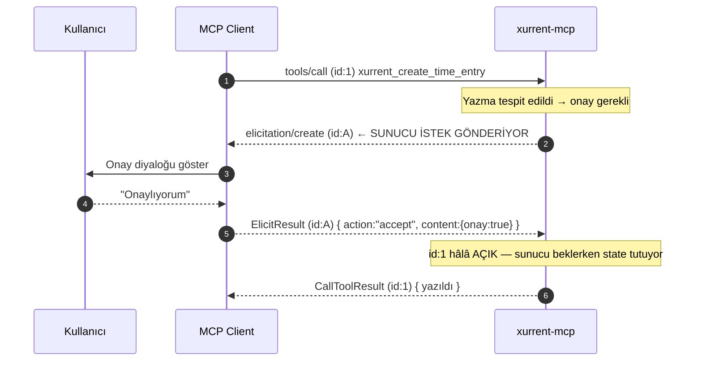
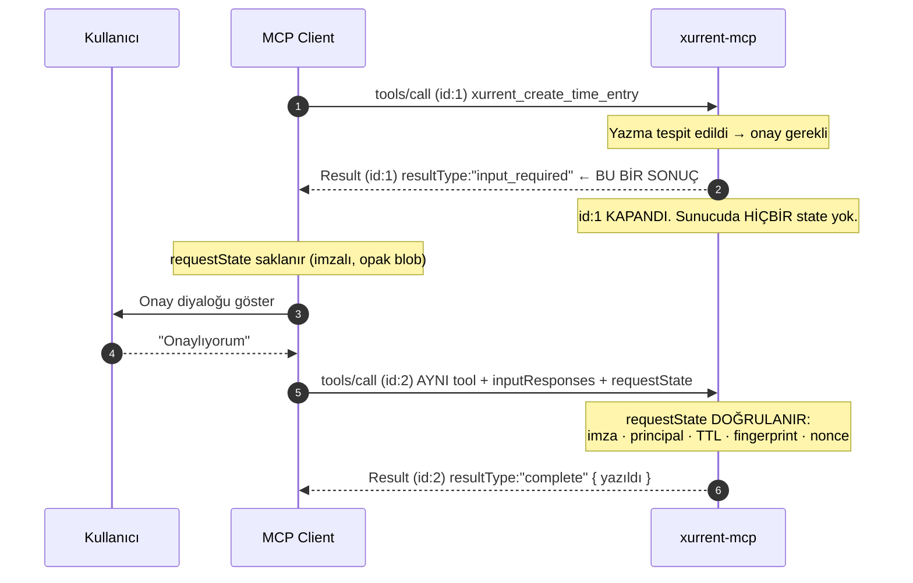

# 09 — Protokol geçişi: `2026-07-28`

> **Bölüm hedefi:** MCP'nin lansmandan bu yana yaşadığı en büyük revizyonu anlamak,
> bu revizyonun **tam olarak bizim onay akışımızı** kaldırdığını görmek, ve bir
> breaking change'in iyi katmanlanmış bir projeye **kaça mal olduğunu** ölçmek.

| ← Önceki | Sonraki → |
|---|---|
| [08 — Riskler ve SSS](08-riskler-ve-sss.md) | [Demo senaryosu](demo/senaryo.md) |

Sözleşme metni: [`contract/protocol.md`](../contract/protocol.md).
Sihirbaz karşılığı: [`docs/wizard/steps.json`](wizard/steps.json) → `12-spec-degisti`, `13-iki-kabuk`.

---

## Bir cümlede ne oldu?

> 28 Temmuz 2026 revizyonu MCP'nin **çekirdeğini stateless yaptı** ve bunu yaparken
> sunucunun kullanıcıya doğrudan soru sorma yeteneğini (`elicitation/create`) kaldırdı.

Bu bizim için akademik bir konu değil. Bu projenin **en önemli güvenlik kararı**
"zaman girişi yazmadan önce kullanıcıdan protokol seviyesinde onay al" idi
([03 — Onay neden LLM'e bırakılmaz](03-mcp-tasarimi.md#onay)). Yeni revizyon o
mekanizmayı olduğu gibi silmiyor — **ters çeviriyor.**

| | `2025-11-25` (v1) | `2026-07-28` (v2) |
|---|---|---|
| Durum | Önceki revizyon, hâlâ yaygın | **Güncel** |
| Bağlantı | `initialize` → `notifications/initialized` el sıkışması | El sıkışma **yok** |
| Sürüm bildirimi | Handshake'te bir kez | **Her istekte** `_meta` içinde |
| Yetenek bildirimi | Handshake'te bir kez | **Her istekte** `_meta` içinde |
| Keşif | `initialize` sonucu | **`server/discover`** (zorunlu RPC) |
| HTTP oturumu | `Mcp-Session-Id` header'ı | **Yok** |
| Sonuç zarfı | düz `Result` | `resultType` **zorunlu** |
| Kullanıcıya soru | Sunucu-başlatmalı `elicitation/create` | **MRTR** — `InputRequiredResult` |
| Liste cache | yok | `ttlMs` + `cacheScope` **zorunlu** |
| SSE koparsa | `Last-Event-ID` ile devam | **Yok** — yeni id ile baştan |

---

## Neden değişti?

Değişikliğin tek bir teknik gerekçesi var ve gerisi ondan türüyor: **stateless çekirdek.**

v1'de bir MCP sunucusu **oturumludur**. `initialize` ile başlayan bir el sıkışma,
`Mcp-Session-Id` ile taşınan bir oturum kimliği, `logging/setLevel` ile o oturuma
bağlanmış bir log seviyesi, `Last-Event-ID` ile devam ettirilebilen bir SSE akışı ve
en önemlisi **sunucudan istemciye giden istekler** (`elicitation/create`,
`sampling/createMessage`, `roots/list`) vardır.

Bunların hepsi tek bir şeyi zorunlu kılar: **kalıcı, çift yönlü, yapışkan bir bağlantı.**

Bu, tek kullanıcılı bir stdio alt süreci için bedavadır. Bir servis olarak
çalıştırıldığında ise şunu dayatır:

| v1'in dayattığı | Operasyonel bedeli |
|---|---|
| Oturum kimliği sunucu belleğinde | **Sticky session** — load balancer'ın aynı istemciyi aynı pod'a göndermesi gerekir |
| Sunucudan istemciye istek | Bağlantı ömrü boyunca açık kanal; pod restart'ı = kopan diyalog |
| SSE resumability | Sunucunun event geçmişini tutması |
| Yatay ölçeklenme | Pod'lar arasında oturum paylaşımı ya da yapışkanlık şart |

Yeni revizyonun cevabı: **sunucu hiçbir şey hatırlamasın.** İstemci her istekte kim
olduğunu, hangi sürümü konuştuğunu ve hangi yetenekleri desteklediğini `_meta` içinde
yeniden söylesin. Sunucunun taşıması gereken bir durum varsa onu **istemciye geri
versin** ve istemci bir sonraki istekte geri getirsin.

> Bu, HTTP'nin cookie/JWT'ye gitmesiyle **aynı** hikâyedir. Durum sunucudan
> istemciye taşınır — ve tam da bu yüzden **imzalanması** gerekir. Bkz.
> [`requestState` bir güvenlik sınırıdır](#requeststate).

---

## Kaldırılanlar

| Kaldırılan | v1'deki işi | v2'de yerine ne var |
|---|---|---|
| `initialize` + `notifications/initialized` | El sıkışma, sürüm ve yetenek pazarlığı | Yok. Her istekte `_meta` |
| `Mcp-Session-Id` header'ı | HTTP oturumu | Yok. Sunucu durumu tool argümanındaki handle'larda |
| `ping` | Bağlantı canlılığı | Yok. Bağlantı zaten kalıcı değil |
| `logging/setLevel` + `notifications/message` | Oturum ömrü boyunca log seviyesi | İstek başına `_meta.io.modelcontextprotocol/logLevel` |
| SSE resumability (`Last-Event-ID`) | Kopan akışı kaldığı yerden sürdürme | Yok. İstek **yeni id ile baştan** |
| `notifications/roots/list_changed` | İstemci kök dizinlerinin değiştiğini bildirme | Yok (Roots zaten deprecated) |
| `elicitation/create` | **Sunucunun kullanıcıya soru sorması** | **MRTR** — [aşağıda](#mrtr) |

`ping`'in kalkması küçük görünür ama semantiği anlatır: v2'de "canlı mı?" diye
sorulacak bir bağlantı yoktur. Her istek kendi başına ayakta durur.

---

## Gelenler

### `server/discover` — zorunlu keşif RPC'si

`initialize` gittiği için sunucunun ne olduğunu ve ne konuştuğunu söyleyen bir yere
ihtiyaç var. `server/discover` bu.

> **⚠️ `_meta` olmadan çağrılırsa REDDEDİLİR.** Ölçtük — bkz. [Ölçüm sonucu](#olcum).
> Zorunlu `_meta` anahtarları:
>
> - `io.modelcontextprotocol/protocolVersion`
> - `io.modelcontextprotocol/clientCapabilities`
> - `io.modelcontextprotocol/clientInfo`

Bu üçü, v1'de `initialize` gövdesinde **bir kez** gönderilen bilginin ta kendisidir.
v2 onları el sıkışmadan söküp **her isteğin zarfına** koydu. Stateless olmanın bedeli
budur: bilgi kaybolmaz, **tekrarlanır.**

### `resultType` — zorunlu sonuç zarfı

Her sonuç `resultType` taşır: `"complete"` veya `"input_required"`.

```jsonc
{ "resultType": "complete",       "content": [ /* ... */ ] }
{ "resultType": "input_required", "inputRequests": { /* ... */ }, "requestState": "<imzalı blob>" }
```

İstemci kuralı: **alanı olmayan bir sonucu `"complete"` say.** Bu, eski sunucularla
uyumluluk için bilinçli bırakılmış bir boşluktur.

### `ttlMs` + `cacheScope` — liste cache'i

`tools/list` sonucu artık **kendi tazeliğini beyan eder**. Bizim tool listemiz statik:

```jsonc
{ "resultType": "complete", "tools": [ /* 8 tool */ ], "ttlMs": 300000, "cacheScope": "public" }
```

Ve buna bağlı ikinci bir kural: **`tools/list` deterministik sırada dönmeli.** Sıra
değişirse LLM prompt cache'i ıskalar. Sözleşmedeki sıra
([`contract/tools.json`](../contract/tools.json)) tam da bu yüzden korunur — üç
sunucu da 4 okuma → 2 yazma → 1 takvim → 1 önizleme sırasını uygular.

### `Mcp-Method` ve `Mcp-Name` header'ları

Streamable HTTP POST'larında **zorunlu**. Gövdeyi açmadan yönlendirme, oran sınırlama
ve yetkilendirme yapılabilsin diye: proxy artık `tools/call` ile `tools/list`'i
JSON'ı parse etmeden ayırt edebilir.

Bizim için pratik sonucu: `xurrent_create_time_entry` çağrısı bir ters vekilde
**gövdeye bakılmadan** ayrı bir politikaya sokulabilir. Yazma tool'larını okuma
tool'larından ayırmanın bedava bir katmanı.

### `extensions` çerçevesi

Spec dışı yeteneklerin **ad alanlı** ve **pazarlığa tabi** biçimde eklenmesi için
resmî bir yer. Daha önce herkes `_meta` içine kendi anahtarını atıyordu; artık bunun
bir sözleşmesi var. Bu projede kullanmıyoruz — ama "kendi alanını nereye koyacaksın"
sorusunun cevabı artık "`extensions`".

---

<a id="mrtr"></a>

## ★ MRTR — onay akışının tersine dönmesi

**MRTR = Multi Round-Trip Requests.** Sunucunun kullanıcıdan bilgi istemesinin
v2'deki tek yolu.

### v1 — sunucu kullanıcıya doğrudan sorar



Dikkat edilecek nokta **`id:1`'in ne kadar açık kaldığı**. Sunucu, kullanıcı
diyaloğa cevap verene kadar o isteğin bağlamını bellekte tutmak zorundadır. Sunucu
**stateful**'dur; bağlantı **çift yönlü** olmak zorundadır.

### v2 — sunucu "eksik bilgi var" diye SONUÇ döner



İlk istek **sonlanır**. Sunucu hiçbir şey hatırlamaz — ihtiyacı olan her şeyi
`requestState` içine kodlar ve istemci onu geri getirir.

### JSON-RPC `id` neden **farklı** olmak zorunda?

Bu, geçişte en çok yanlış yapılan yer. Üç ayrı sebep var ve üçü de bağlayıcı:

**1 — `id:1` zaten cevaplandı.** JSON-RPC 2.0'da bir `id`, uçuştaki bir isteği
tanımlar. `InputRequiredResult` bir **hata değil, bir sonuçtur**; onu alan istemci
`id:1`'i kapatır ve bekleyen istekler tablosundan siler. Aynı `id` ile ikinci bir
istek göndermek, kapatılmış bir kaydı yeniden açmaya çalışmaktır.

**2 — İstemcinin korelasyon tablosu bozulur.** Neredeyse tüm istemci
implementasyonları `id → pending promise` şeklinde bir eşleme tutar. Aynı `id` iki
kez kullanılırsa ya ikinci istek "duplicate id" ile reddedilir ya da birinci isteğin
çoktan çözülmüş promise'ine ikinci cevap yazılmaya çalışılır. İkisi de sessiz
arızadır.

**3 — Bağ `id` değil, `requestState`'tir.** İki isteği birbirine bağlayan şey
protokol seviyesinde **hiçbir şey** değildir; bağ tamamen `requestState` blob'unun
içindedir. Aynı `id`'yi kullanmak, olmayan bir ilişkiyi varmış gibi göstermekten
başka bir işe yaramaz — ve geliştiriciyi "sunucu bir şey hatırlıyor olmalı" diye
yanlış bir zihinsel modele iter.

> **Kural:** İki `tools/call` **bağımsız isteklerdir**. `id`'leri farklı, `requestState`
> aynıdır.

### Ne değişti, ne değişmedi?

| | v1 | v2 |
|---|---|---|
| Onayı **kim** ister | Sunucu | Sunucu |
| Onayı **kim** verir | Kullanıcı | Kullanıcı |
| LLM araya girebilir mi | ❌ | ❌ |
| Sunucu state tutar mı | ✅ (istek açık kalır) | ❌ |
| Kaç JSON-RPC isteği | 1 (+1 ters yön) | 2 |
| Bağlantı çift yönlü olmalı mı | ✅ | ❌ |

**Güvenlik vaadi aynen korunur:** onay hâlâ LLM'in dışındadır. Değişen tek şey
**taşıma biçimi**. Bu, dersin ana mesajının somut kanıtı — protokol değişti, güvenlik
modeli değişmedi, çünkü model protokolde değil **mimaride** yaşıyor.

---

<a id="requeststate"></a>

## ★ `requestState` bir güvenlik sınırıdır

Spec bunu açıkça **saldırgan kontrolündeki girdi** olarak tanımlar. Sebebi basit:
`requestState` sunucudan çıkıp **istemcide** bekler ve geri gelir. Aradaki süre
boyunca sunucunun onun üzerinde hiçbir kontrolü yoktur.

Bizim durumumuzda o blob şunu taşıyor:

> *"Kullanıcı Ayşe Demir, Request #70248'e 120 dakika yazmayı onayladı."*

İmzasız bırakılırsa istemci (ya da istemciyi ele geçiren herhangi bir şey) bunu
**başka bir ticket'a, başka bir süreye, başka bir kişiye** çevirebilir. Ve dikkat:
kullanıcıya gösterilen onay diyaloğu doğru metni göstermiş olur. Onay gerçekten
alınmıştır — sadece **başka bir şey için** kullanılmıştır.

Bu repodaki şema (`servers/typescript/src/core/confirm.ts:34-45`):

```typescript
export interface RequestStatePayload {
  principal: string;    // Authenticated person node id.
  fingerprint: string;  // sha256(metod adı + kanonik argümanlar).
  nonce: string;        // Tek kullanımlık rastgele değer.
  exp: number;          // Unix saniye — bu andan sonra state geçersizdir.
  tool: string;         // Hangi tool için üretildi (teşhis ve okunabilirlik için).
}
```

Wire biçimi: `v1.<base64url(payload)>.<base64url(HMAC-SHA256(secret, "v1."+payload))>`

Örnek bir `principal` değeri — [`fixtures/people.json`](../fixtures/people.json)
içindeki **gerçek** mock kayıt: `TW9jay9QZXJzb24vMQ` (Ayşe Demir, authenticated user).

> ### ★ Dikkat: onaylanan işin kendisi blob'un İÇİNDE DEĞİL
>
> Payload'da `targetId`, `minutes` gibi alanlar **yok**. Onaylanan iş, ikinci
> `tools/call` isteğinde **argüman olarak** yeniden gelir; blob yalnızca o
> argümanların **parmak izini** taşır.
>
> Bu, blob'u küçük tutmaktan öte bir seçim: sunucu, kullanıcının onayladığı işi
> hatırlamak yerine **client'ın getirdiği işin onaylanan işle aynı olduğunu
> doğrular**. Fingerprint tutmazsa reddeder. Aynı güvenceyi verir, sunucuyu
> gerçekten stateless bırakır.

### Her önlemin **neden**i

| Önlem | Hangi saldırıyı kapatır | Neden bu şekilde |
|---|---|---|
| **HMAC-SHA256** | İstemcinin blob'u **düzenlemesi** | Gizlilik değil, **bütünlük** gerekiyor. İçerik zaten kullanıcının gördüğü şey — sır değil. Şifreleme gereksiz maliyet olurdu; imza yeterli ve doğrulaması ucuz |
| **`principal`** | **Çapraz kullanıcı** kullanımı — B kullanıcısının, A'nın onay blob'unu kendi isteğine iliştirmesi | Onay bir **kişiye** verilir. Doğrulamada authenticated person ile karşılaştırılır; farklıysa reddedilir |
| **`exp` (5 dk TTL)** | **Geciktirilmiş** kullanım — dün alınmış onayın bugün kullanılması | Onay **taze** olmalıdır. Kullanıcı "evet" dediğinde bugünkü bağlamı onaylar; iki gün sonra o bağlam yoktur |
| **`fingerprint`** | **Çapraz istek** kullanımı — "30 dk, ticket X" onayının "300 dk, ticket Y" çağrısına iliştirilmesi | En kritik önlem. Onay bir **çağrıya** bağlanır, genel bir "yazma izni"ne değil. Metod adı + kanonikleştirilmiş argümanların SHA-256'sı; tek karakter değişse eşleşme bozulur |
| **`nonce`** | **Replay** — aynı çağrının aynı state ile TTL penceresi içinde tekrar edilmesi | Bizim alanımızda replay = **çift yazma**. Ve Yol B'de `timeSpent` **artımlıdır** ([02](02-zaman-girisi-modeli.md)): aynı çağrı iki kez = iki kayıt = **iki kez faturalama.** Tek kullanımlık nonce bunu kapatır |

`nonce` maddesi tesadüf değil. Spec'in kendi uyarısı şu: imza + TTL + fingerprint
replay penceresini **daraltır** ama **tek kullanımı garanti etmez**. Tek kullanım
şartsa sunucu bunu ayrıca zorlamalıdır. Bizim iş alanımızda tek kullanım şart —
çünkü `idempotentHint: false` ([03](03-mcp-tasarimi.md)) bir süsleme değil, gerçeğin
kendisi.

### Doğrulama sırası fail-closed'dır

```typescript
// servers/typescript/src/core/confirm.ts:119-127  (fonksiyon başı yorumu)
/**
 * Doğrulama FAIL-CLOSED'dır: en ufak şüphede false döner ve çağıran YAZMAZ.
 * Sıra önemlidir — önce imza (ucuz ve kesin), sonra semantik kontroller.
 */
```

Sıra: **biçim → imza → TTL → principal → fingerprint → nonce.** Önce imzayı kontrol
etmek yalnızca performans değil, **güvenlik** meselesidir: imzası geçersiz bir
payload'ın içeriğine hiç bakılmaz.

İki ince ayrıntı gerçek koddan:

```typescript
// servers/typescript/src/core/confirm.ts:144-145
// timingSafeEqual uzunluklar farklıysa FIRLATIR — önce uzunluğu kontrol et.
if (givenMac.length !== expectedMac.length || !timingSafeEqual(givenMac, expectedMac)) { /* … */ }
```

```typescript
// servers/typescript/src/core/confirm.ts:78-82  (canonical() üstündeki yorum)
// Argümanların KANONİK gösterimi: anahtarlar sıralanır, böylece aynı argüman
// kümesi her zaman aynı parmak izini üretir. JSON.stringify'ın anahtar sırası
// girdiye bağlıdır; sıralamazsak aynı çağrı farklı parmak izi verebilir.
```

İkincisi sinsi bir hata kaynağıdır: kanonikleştirme yapılmazsa **doğru** bir onay,
yalnızca istemci argümanları farklı sırada serileştirdiği için reddedilir. Kullanıcı
"onayladım ama olmadı" der, log'da "fingerprint tutmuyor" yazar, ve saatler gider.

### Sırrın kaynağı

`XURRENT_STATE_SECRET` yoksa süreç başlangıcında **rastgele** üretilir:

```typescript
// servers/typescript/src/core/confirm.ts:55-59  (yorum)
// İmza anahtarı süreç ömrü boyunca SABİTTİR.
// XURRENT_STATE_SECRET boşsa rastgele üretilir → sunucu yeniden başladığında
// eski state'ler geçersiz olur. Bu bir kusur değil, İSTENEN davranıştır:
// stateless sunucunun "unutması" beklenir.
```

Yeniden başlamış bir sunucu, kendisinin üretmediği bir onayı kabul etmemelidir.
Kullanıcı onayı bir kez daha verir — maliyeti bir tıklama, alternatifi bilinmeyen
kaynaklı bir yazma.

### ⚠️ İmzalı ≠ şifreli

```typescript
// servers/typescript/src/core/confirm.ts:23-24  (dosya başı yorumundan)
// KRİTİK: Bu blob İMZALIDIR, ŞİFRELİ DEĞİLDİR. Client base64url'ü çözüp içeriği
// OKUYABİLİR. İçine sır konmaz.
```

Payload'da `principal` (bir node id) ve `tool` adı var — ikisi de zaten client'ın
bildiği şeyler. **Blob'a token, e-posta, iç açıklama koymak bir sızıntıdır.**

### ⚠️ Dürüst uyarı: nonce seti stateless değildir

Nonce'ları süreç içi bir sette tutuyoruz. Bu, tek süreçli stdio kurulumunda
kusursuz çalışır — ama **v2'nin motivasyonuyla çelişir**: yatay ölçeklenen bir
kurulumda ikinci pod, birinci pod'un harcadığı nonce'u bilmez.

Üretimde doğru çözüm paylaşılan bir kısa ömürlü depodur (Redis vb.,
TTL = state TTL'i). Bunu bilerek yapmadık; ders materyalinin kapsamı dışında.
**Ama kapsam dışı olduğunu yazmak, kapsamın içindedir.**

> Genel ders: *stateless protokol, stateless uygulama demek değildir.* Replay
> koruması bir yerde durum tutmayı **zorunlu** kılar. Protokol o durumu senden
> istemiyor olabilir; **tehdit modelin istiyor.**

---

## Deprecate edilenler

Bunlar kaldırılmadı — **12 aylık pencereyle** kullanımdan kaldırılma sürecine girdi.
Spec'in [feature lifecycle](https://modelcontextprotocol.io/community/feature-lifecycle)
politikası, deprecate edilen bir özelliğin en az bir revizyon boyunca çalışmaya devam
etmesini garanti eder.

| Özellik | Ne işe yarardı | Bizdeki durum |
|---|---|---|
| **Roots** | İstemcinin sunucuya kök dizinlerini bildirmesi | **Kullanmıyoruz.** Dosya sistemi erişimimiz yok |
| **Sampling** | Sunucunun istemciden LLM tamamlaması istemesi | **Kullanmıyoruz.** LLM çağrılarımız chatbot katmanında |
| **Logging** | `logging/setLevel` + `notifications/message` | **Kullanmıyoruz.** Kuralımız zaten "loglar stderr'e" ([03](03-mcp-tasarimi.md)) |
| **HTTP+SSE transport** | 2024-11-05'ten kalma iki uçlu transport | Streamable HTTP kullanıyoruz |
| **OAuth Dynamic Client Registration** | İstemcinin kendini sunucuya dinamik kaydettirmesi (RFC 7591) | Kullanmıyoruz; yerine **CIMD** (Client ID Metadata Document) geliyor — ayrıntı [changelog](https://modelcontextprotocol.io/specification/2026-07-28/changelog)'da |

**Üçünde de "kullanmıyoruz" yazması bir tesadüf değil.** Bu proje protokolün en dar
yüzeyini seçti: tool'lar, ve tek bir sunucu→istemci geri kanalı (elicitation). Dar
yüzey, revizyon geldiğinde küçük bir hasar alanı demektir. Sampling kullansaydık bu
bölüm çok daha uzun olurdu.

> **Tasarım ilkesi:** *Protokolün kullandığın yüzeyi, yaşayacağın breaking change'in
> yüzeyidir.*

---

## Hata kodları yeniden numaralandı

v2, JSON-RPC hata kodu aralıklarını netleştirdi:

| Aralık | Kime ait |
|---|---|
| `-32000` … `-32019` | **İmplementasyona** ait (senin kendi hata kodların) |
| `-32020` … `-32099` | **Spec'e** ayrılmış |

Bunun sonucu olarak taşınan kodlar:

| Hata | v1 | v2 |
|---|---|---|
| `UnsupportedProtocolVersion` | `-32004` | **`-32022`** |
| `MissingRequiredClientCapability` | `-32003` | **`-32021`** |
| `HeaderMismatch` | `-32001` | **`-32020`** |
| `resources/read` — bulunamadı | `-32002` | **`-32602`** (Invalid params) |

Son satır bir semantik düzeltmedir: "istenen resource yok" özel bir MCP hatası değil,
**geçersiz parametredir**. Standart JSON-RPC kodu zaten vardı.

> **Geçiş tuzağı:** hata kodlarını sabit sayı olarak karşılaştıran istemci kodu
> sessizce yanlış davranır — kod artık eşleşmez, `catch` bloğu tutmaz, hata "bilinmeyen"
> kategorisine düşer. Kodları **sabit isimlerle** karşılaştır, sayılarla değil.

---

<a id="olcum"></a>

## ★ Ölçüm sonucu — hangi SDK neyi konuşuyor?

Bu bölümdeki tablo **tahmin değil**. Üç sunucuya ham JSON-RPC istekleri gönderildi ve
cevapları kaydedildi (2026-08-02).

### Sonda 1 — `server/discover` ve `initialize`

| Dil | SDK sürümü | `server/discover` | `initialize` | Sonuç |
|---|---|---|---|---|
| **TypeScript** | `@modelcontextprotocol/sdk` **1.30.0** | ❌ `-32601` Method not found | ✅ `protocolVersion: 2025-11-25` | **Yalnızca v1** |
| **Python** | `mcp` **2.0.0** | ✅ `supportedVersions: ["2026-07-28"]` | ✅ `protocolVersion: 2025-11-25` | **İkisi de** |
| **C#** | `ModelContextProtocol` **2.0.0** | ✅ `supportedVersions: ["2026-07-28"]` | ✅ `protocolVersion: 2025-11-25` | **İkisi de** |

### Sonda 2 — `server/discover`, `_meta` **olmadan**

Aynı istek, `_meta` alanı çıkarılarak tekrarlandı:

| Dil | Cevap | Not |
|---|---|---|
| **Python** | `-32601` Method not found | **Yanıltıcı mesaj.** Metod var; eksik olan `_meta`. Bunu bilmeden hata ayıklamak saat kaybettirir |
| **C#** | `-32602` *"The `server/discover` request requires per-request metadata declaring a supported protocol version."* | Doğru kod, açık mesaj |

Zorunlu `_meta` anahtarları:

```jsonc
"_meta": {
  "io.modelcontextprotocol/protocolVersion":   "2026-07-28",
  "io.modelcontextprotocol/clientCapabilities": { /* ... */ },
  "io.modelcontextprotocol/clientInfo":         { "name": "…", "version": "…" }
}
```

### ★ Ders çıkarımı

> **Resmî SDK'lar protokolün geriye dönük uyumluluğunu KENDİLERİ taşıyor —
> ama onay akışının iki hâlini taşımıyorlar.**

Bu ayrımı yapmak önemli, çünkü ölçüm iki farklı soruyu birbirinden ayırdı:

| Soru | Cevap |
|---|---|
| **İki protokol SÜRÜMÜ** konuşmak için iki SDK sürümü gerekiyor mu | **Python/C#: hayır.** 2.0.0 ikisini de konuşuyor. **TypeScript: evet**, çünkü `sdk@1.30.0` `server/discover`'ı hiç bilmiyor |
| **İki onay AKIŞI** (elicitation ↔ MRTR) için iki adaptör gerekiyor mu | **Üç dilde de evet.** Bu bir taşıma farkı değil, **akış** farkı: birinde `await`, diğerinde `return` |

İkinci satır, iki adaptörün neden **yine de** yazıldığını açıklıyor. Python'un
kendi dosya başı yorumları farkı tek cümlede özetliyor:

```python
# servers/python/src/xurrent_mcp/mcp/v1.py:8-10  (docstring)
# Sunucu, islemin ORTASINDA client'a bir ISTEK gonderir. Bu kalici cift yonlu bir
# baglanti gerektirir — yani sunucu stateful'dur. `await` satiri tam olarak burasi:
# handler, cevap gelene kadar acik durur.
```

```python
# servers/python/src/xurrent_mcp/mcp/v2.py:11-14  (docstring)
# Ilk istek SONLANIR. Sunucu hicbir state tutmaz — ihtiyaci olan her seyi
# `requestState` icine kodlar ve client onu geri getirir. v1.py'deki `await
# ctx.session.elicit_form(...)` satirinin karsiligi burada YOKTUR; onun yerine
# bir `return` vardir. Farkin tamami budur.
```

> ## Farkın tamamı: bir `await` yerine bir `return`
>
> İki dosyayı yan yana okumak, bu bölümün tamamını okumaya bedeldir. Sihirbazın
> **13. adımı** (`13-iki-kabuk`) tam olarak bunu yaptırır.

Ölçümün pratik sonucu şuydu:

1. **Bağımlılık izolasyonu problemi yalnızca TypeScript'te yaşandı** — ve orada
   en kolay ekosistemdi. Python ve C# tek paket sürümüyle iki era'yı da konuşuyor.
2. **Adaptör sayısı protokolden değil, akış farkından geliyor.** SDK yükseltmek
   `server/discover`'ı getirir ama `elicitation/create` → `InputRequiredResult`
   dönüşümünü senin yerine yapmaz.
3. **TypeScript'in v1 adaptörü bir gün silinecek.** `sdk@1.30.0` yalnızca eski
   era'yı servis ettiği için duruyor; TS 2.0.0'a tam geçildiğinde o paket düşer,
   `v1/server.ts` ise **ders materyali olarak** kalabilir.

> **Ölçmeden yazma.** Bu bölümün ilk taslağı "üç dilde de iki SDK sürümü gerekir"
> diyordu. Ham JSON-RPC sondası bunun **üçte ikisinin gereksiz** olduğunu gösterdi —
> ama aynı zamanda iki adaptörün gerekli olduğunu **başka bir sebeple** doğruladı.
> Bir varsayımın maliyeti, onu doğrulamanın maliyetinden neredeyse her zaman yüksektir.

### Sihirbazın uyumluluk sondası

Sihirbaz aynı testi ders sırasında **canlı** yapar ve hangi protokolü konuştuğunu
ekrana basar:

```
1. server/discover gönder
   ├─ başarılı            → v2. Dönen supportedVersions'a bak
   └─ "method not found"  → v1. initialize handshake'ine düş
```

`--server ts` ile ikinci dal, `--server py|cs` ile birinci dal çalışır. Pazarlığın
gerçekten işlediği, iddia edilmez — **gösterilir** ([07](07-sihirbaz.md)).

---

<a id="bagimlilik"></a>

## Bağımlılık izolasyonu — üç ekosistem, üç farklı problem

İki SDK sürümünü **aynı anda** yüklemek gerekseydi ne olurdu? Cevap dile göre
tamamen değişiyor:

| Dil | v1 paketi | v2 paketi | Yan yana durabilir mi |
|---|---|---|---|
| **TypeScript** | `@modelcontextprotocol/sdk@1.30.0` | `@modelcontextprotocol/{core,server,client}@^2.0.0` | ✅ **Farklı paket adları** → aynı `node_modules`'da sorunsuz |
| **C#** | `ModelContextProtocol` 1.x | `ModelContextProtocol` 2.0.0 | ❌ **Aynı paket ID** → tek `.csproj`'da imkânsız. Çözüm olurdu: `XurrentMcp.Core` + `.V1` + `.V2` olarak **üç proje** |
| **Python** | `mcp==1.28.1` | `mcp==2.0.0` | ❌ **Aynı paket adı** → tek ortamda imkânsız. Çözüm olurdu: `uv run --with 'mcp==1.28.1' …` ile geçici override ya da ayrı dependency group |

Bu tablo tek başına bir derstir: *aynı problem, üç ekosistemde üç farklı çözüm.*
Paket yöneticisinin **sürüm çakışmasını nasıl modellediği** mimarini belirler.

### Ölçümden sonra: problem yalnızca TypeScript'te GERÇEKLEŞTİ

| Dil | Kurulu paketler | Zor durum yaşandı mı |
|---|---|---|
| **TypeScript** | `@modelcontextprotocol/sdk@1.30.0` **+** `@modelcontextprotocol/{core,server,client}@^2.0.0` | ✅ İki sürüm gerçekten yan yana duruyor — **ama sorunsuz**, çünkü paket adları farklı |
| **Python** | tek `mcp==2.0.0` | ❌ Gerekmedi — SDK iki era'yı da konuşuyor |
| **C#** | tek `ModelContextProtocol` 2.0.0 (+ `.AspNetCore`) | ❌ Gerekmedi — aynı sebeple |

Yani:

- **C# üç projeye bölünmedi.** "Aynı paket ID" sorunu hiç yaşanmadı.
- **Python `uv run --with` numarasına başvurmadı.**
- **TypeScript'te iki paket kümesi gerçekten yan yana kuruldu** — ve bu, tablodaki
  **en kolay** senaryoydu.

> ### ★ Şansın nerede durduğuna dikkat
>
> Bağımlılık izolasyonu problemi, onu **en ucuza** çözebilen ekosistemde çıktı.
> Aynı gecikme C# veya Python tarafında olsaydı bedeli üç proje ya da ayrı bir
> sanal ortam olurdu.
>
> Ders buradan çıkıyor: **bir SDK'nın protokol sürümünde geride kalması, o dilin
> paket yöneticisinin sürüm çakışmasını nasıl modellediğiyle çarpılır.** İkisi
> bağımsız görünür; birlikte maliyeti belirlerler.

---

<a id="maliyet"></a>

## "Breaking change bize kaça mal oldu?"

Dersin asıl sorusu bu. Cevap: **ince bir adaptör katmanı.**

Sebep, protokol revizyonundan **önce** verilmiş bir karardır: iş mantığı
protokolden ayrı tutuldu.

Şema üç dilde de aynı, dosya adları ekosisteme göre değişiyor:

| Rol | TypeScript | Python | C# |
|---|---|---|---|
| Saf tool mantığı | `src/core/toolimpl.ts` | `core/toolimpl.py` | `Core/ToolImpl.cs` |
| Şemalar | `src/core/schemas.ts` | `core/schemas.py` | `Core/ToolContracts.cs` |
| `requestState` imza/doğrulama | `src/core/confirm.ts` | `core/confirm.py` | `Core/Confirm.cs` |
| Ortak sunucu bilgisi | `src/mcp/shared.ts` | `mcp/common.py` | `Mcp/ServerSetup.cs` |
| **v1 adaptörü** | `src/mcp/v1/server.ts` | `mcp/v1.py` | `Mcp/McpTools.cs` |
| **v2 adaptörü** | `src/mcp/v2/server.ts` | `mcp/v2.py` | *(aynı dosyada)* |
| Yan yana koşturma | `src/mcp/protocols.ts` | — | — |

Kritik kural: **`core/toolimpl` bir tool'u çalıştırırken onay gerekiyorsa
`ConfirmationRequired` döner — *nasıl sorulacağını bilmez.*** Protokole çeviren
adaptördür.

```
                    ┌─ mcp/v1 ─→ elicitation/create   (sunucu İSTEK gönderir)
core/toolimpl ──────┤
  ConfirmationRequired
                    └─ mcp/v2 ─→ InputRequiredResult  (sunucu SONUÇ döner)
```

### v2 adaptörünün iki turu — gerçek kod

```typescript
// servers/typescript/src/mcp/v2/server.ts:125-183  (kesilerek)
async (args: Record<string, unknown>, reqCtx: ServerContext) => {
  const echoed = reqCtx.mcpReq.requestState<string>();

  // ── İKİNCİ TUR: client onayı ve requestState'i geri getirdi ──────────
  if (echoed !== undefined) {
    const principal = (await ctx.xurrent.whoami(signal)).person.id;
    const check = verifyRequestState(cfg, echoed, { principal, tool: spec.name, args });
    if (!check.ok) {
      return failure(
        `Onay bilgisi (requestState) DOĞRULANAMADI — hiçbir şey yazılmadı.\n${check.reason}\n\n` +
          "Bu blob client üzerinden geçtiği için spec onu 'saldırgan kontrolündeki girdi' sayar; " +
          "imza, principal, argüman parmak izi, TTL ve tek kullanımlık nonce kontrollerinden biri tutmadı.",
        { errors: [{ message: check.reason }] },
      );
    }
    return toToolResult(await runToolCore(ctx, spec.name, args, readDecision(reqCtx), signal));
  }

  // ── BİRİNCİ TUR ──────────────────────────────────────────────────────
  const first = await runToolCore(ctx, spec.name, args, undefined, signal);
  if (first.kind === "ok") return toToolResult(first);
  // … client soru soramıyorsa politika devreye girer …

  return inputRequired({
    inputRequests: { [CONFIRM_KEY]: inputRequired.elicit({ /* … */ }) },
    // İmzalı, süreli, argümana bağlı, tek kullanımlık. Bkz. core/confirm.ts
    requestState: signRequestState(cfg, {
      principal: (await ctx.xurrent.whoami(signal)).person.id,
      tool: spec.name,
      args: first.resume.args,
    }),
  });
}
```

**Dikkat: `return inputRequired({...})`.** v1 adaptöründe aynı yerde bir `await`
duruyor. Farkın tamamı bu.

### v2'nin zorunlu alanları da burada kuruluyor

```typescript
// servers/typescript/src/mcp/v2/server.ts:97-109  (kesilerek)
const server = new McpServer(SERVER_INFO, {
  capabilities: { tools: {} },
  instructions: SERVER_INSTRUCTIONS,
  // v2 ZORUNLULUĞU: tools/list ve server/discover sonuçlarında ttlMs + cacheScope.
  cacheHints: {
    "tools/list":      { ttlMs: CACHE_TTL_MS, cacheScope: CACHE_SCOPE },
    "server/discover": { ttlMs: CACHE_TTL_MS, cacheScope: CACHE_SCOPE },
  },
  // requestState.verify KASITLI OLARAK BOŞ BIRAKILDI: SDK'nın hook'u
  // doğrulama başarısızlığını wire seviyesinde -32602 hatasına çevirir.
  // Sözleşmemiz ise isError=true + okunabilir TÜRKÇE açıklama istiyor —
  // öğrenci "neden reddedildi"yi görmeli. Bu yüzden doğrulama handler İÇİNDE yapılır.
});
```

Son yorum bir tasarım kararını belgeliyor: **SDK'nın hazır doğrulama hook'u
kullanılmadı**, çünkü onun ürettiği `-32602` bir öğrenciye hiçbir şey anlatmaz.
Doğrulama handler içinde yapılıyor ve Türkçe gerekçe dönüyor. *Öğretici olmak,
bazen kolay yolu seçmemektir.*

### İki kabuk yan yana — sahte kanıt üretmeden

Sihirbazın 13. adımı aynı tool'u iki adaptör altında **gerçekten** çalıştırır:

```typescript
// servers/typescript/src/mcp/protocols.ts:12-14  (dosya başı yorumundan)
// Burada HİÇBİR ŞEY taklit edilmez: her iki yol da gerçek bir MCP client +
// gerçek bir MCP server çifti kurar (InMemoryTransport) ve gerçek JSON-RPC
// mesajları alışverişi yapar. Sahte bir "geçti" üretmek dersin amacını bozardı.
```

```typescript
// servers/typescript/src/mcp/protocols.ts:64-69  (kesilerek)
const client = new ClientV2(CLIENT_INFO, {
  capabilities: { elicitation: {} },
  // PIN: geri düşme YOK. 2026-07-28 konuşulamıyorsa adım sessizce v1'e kaymasın,
  // gürültülü biçimde patlasın — sahte bir "geçti" üretmemenin bedeli budur.
  versionNegotiation: { mode: { pin: V2 } },
});
```

`pin` satırı küçük ama kritik: **sessiz geri düşme, bir testi anlamsız kılar.**
Adım "geçti" derse gerçekten v2 üzerinden geçmiş olmalıdır.

### Neyin değişmesi gerekti, neyin gerekmedi

| Katman | Değişti mi | Neden |
|---|---|---|
| `contract/tools.json` | ❌ | 8 tool, aynı parametreler, aynı çıktı alanları, aynı sayılar |
| `xurrent/` (adapter, queries, strategies, validate) | ❌ | GraphQL ve stratejiler protokolü hiç bilmiyor |
| `calendar/` (providers, normalize) | ❌ | Aynı |
| `core/toolimpl` | ❌ | Saf fonksiyonlar: args in → result out |
| `core/schemas` | ❌ | Girdi/çıktı şemaları protokolden bağımsız |
| `core/confirm` | ⚠️ **eklendi** | `requestState` imzalama/doğrulama v2 ile geldi |
| `mcp/v1` ↔ `mcp/v2` | ✅ | **Değişikliğin tamamı burada** |
| `fixtures/` | ❌ | Aynı veri, aynı beklenen sayılar |
| Sihirbaz `expect` blokları | ❌ | `structuredContent` yolları değişmedi |

**Beklenen mock çıktıları revizyondan sonra da birebir aynı:**

| Tool | Beklenen |
|---|---|
| `xurrent_list_open_work` | `requests.totalCount = 3`, `tasks.totalCount = 3` |
| `xurrent_get_time_tracking_context` | `timeIncrement = 30`, `effortClasses.length = 3` |
| `calendar_list_today` | `rawCount = 8`, `count = 5`, `filteredOut = 3`, `busyMinutes = 225`, `naiveSumMinutes = 255` |
| `plan_time_entries_from_calendar` | `proposals.length = 5` |
| `xurrent_create_time_entry` dry-run, `two_step` | `planned.length = 2` |
| aynısı, `link_first` / `date_first` | `planned.length = 1` |

Ve `node scripts/verify-contract.mjs --all` **her iki protokolde de aynı sözleşmeyi**
doğrular.

### Karşı senaryo: ayırmasaydık ne olurdu?

Eğer `xurrent_create_time_entry`'nin iş mantığı `elicitation/create` çağrısının
etrafına örülmüş olsaydı — ki bu en doğal yazım biçimidir — şunları yeniden
yazmak gerekirdi:

- Onay özetinin üretimi (bulk için 50 satırı tek özete indiren mantık)
- Strateji seçimi ve `planned[]` üretimi
- `decline` / `cancel` ayrımının iş sonucuna çevrilmesi
- Ve bunların **her biri iki kez**, iki protokol için

Yani: sekiz tool'un yazma yolunun tamamı. Bunun yerine ödediğimiz bedel `core/confirm/`
modülü ve `mcp/v2` kabuğu oldu.

> ## Dersin tek cümlesi
>
> **Protokol revizyonu, tool sözleşmeni bozmamalı. İş mantığını protokolden
> ayırdıysan, breaking change seni ince bir adaptör katmanında yakalar — tüm
> uygulamada değil.**

---

## Geçiş kontrol listesi

Kendi MCP sunucunu v2'ye taşıyacaksan sırayla:

| # | Kontrol | Nasıl |
|---|---|---|
| 1 | SDK sürümün iki revizyonu birden konuşuyor mu | Ham `server/discover` sondası at — [ölçüm](#olcum) gibi |
| 2 | `server/discover` çağrılarında `_meta` üç anahtarı da taşıyor mu | Eksikse `-32601`/`-32602` alırsın; Python'un mesajı **yanıltıcıdır** |
| 3 | Tüm sonuçlarda `resultType` var mı | Yoksa istemci `"complete"` sayar — sessiz sorun |
| 4 | `tools/list` `ttlMs` + `cacheScope` beyan ediyor mu | Statik listede `300000` / `"public"` |
| 5 | `tools/list` deterministik sırada mı | Sözleşmedeki sırayı koru |
| 6 | Elicitation kullanıyor muydun | Evetse MRTR'ye taşı; `requestState`'i **imzala** |
| 7 | Hata kodlarını sayı olarak mı karşılaştırıyorsun | İsimlerle karşılaştır; numaralar taşındı |
| 8 | Streamable HTTP POST'larında `Mcp-Method` / `Mcp-Name` var mı | Zorunlu |
| 9 | Logging / Sampling / Roots kullanıyor muydun | Üçü de deprecated; 12 aylık pencere |
| 10 | `stdout` yalnızca JSON-RPC mi | Değişmedi — ama hâlâ bir numaralı hata kaynağı |

---

## Özet

| Konu | Sonuç |
|---|---|
| Değişimin sebebi | **Stateless çekirdek** — sticky session ve yatay ölçeklenme baskısı |
| En büyük kayıp | `elicitation/create` — sunucu artık istek gönderemez |
| Yerine gelen | **MRTR** — `InputRequiredResult` + istemcinin isteği **yeni `id` ile** tekrarlaması |
| Güvenlik modeli | **Değişmedi.** Onay hâlâ LLM'in dışında |
| Yeni sorumluluk | `requestState` **imzalanmalı**: HMAC + principal + TTL + fingerprint + nonce |
| Dürüst kusur | Nonce seti süreç içi — yatay ölçekte paylaşılan depo gerekir |
| Ölçüm | SDK 2.0.0 (py, cs) **iki revizyonu birden** konuşuyor; ts 1.30.0 yalnızca v1 |
| İki SDK sürümü | **Yalnızca TypeScript'te** gerekti — ve orada en kolay ekosistemdi |
| İki adaptör | **Üç dilde de** yazıldı — protokol sürümü için değil, **akış farkı** için (`await` ↔ `return`) |
| Bağımlılık izolasyonu | TS yan yana ✅ (gerçekleşti) · C# aynı paket ID ❌ · Python aynı paket adı ❌ (**ikisi de gerekmedi**) |
| Maliyet | İş mantığı protokolden ayrı olduğu için değişiklik **ince adaptör katmanında** kaldı |
| Tool sözleşmesi | **Değişmedi.** Aynı 8 tool, aynı çıktı alanları, aynı beklenen sayılar |

---

## Kaynaklar

- [Spec 2026-07-28 — Key Changes](https://modelcontextprotocol.io/specification/2026-07-28/changelog)
- [Multi Round-Trip Requests (MRTR)](https://modelcontextprotocol.io/specification/2026-07-28/basic/patterns/mrtr)
- [Versioning ve pazarlık](https://modelcontextprotocol.io/specification/versioning)
- [Feature lifecycle / deprecation policy](https://modelcontextprotocol.io/community/feature-lifecycle)
- [Duyuru yazısı](https://blog.modelcontextprotocol.io/posts/2026-07-28/)

Sunum planı için son durak: [Demo senaryosu](demo/senaryo.md).
