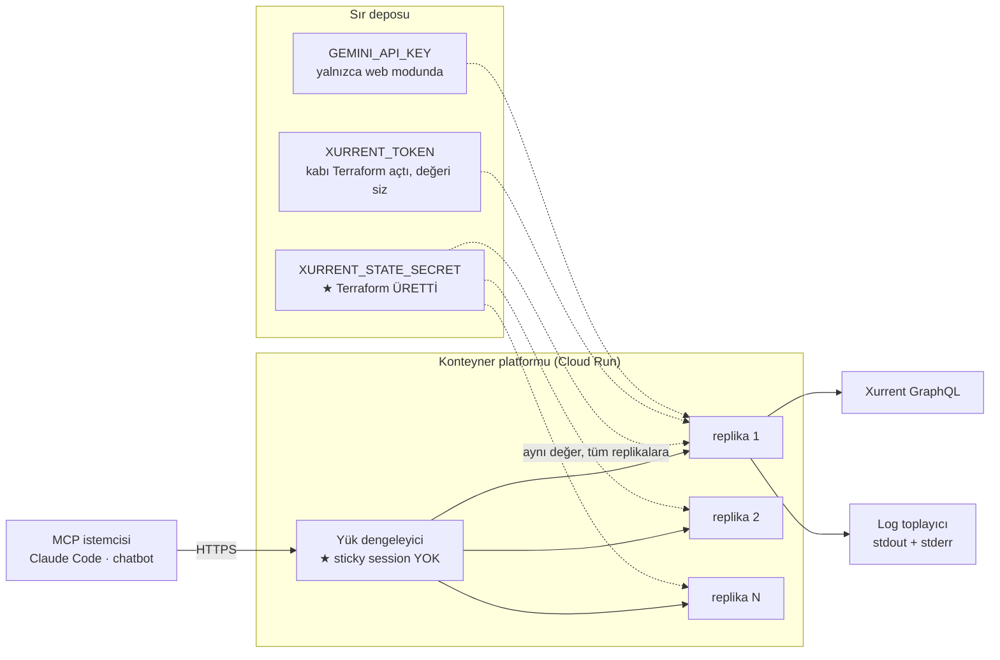
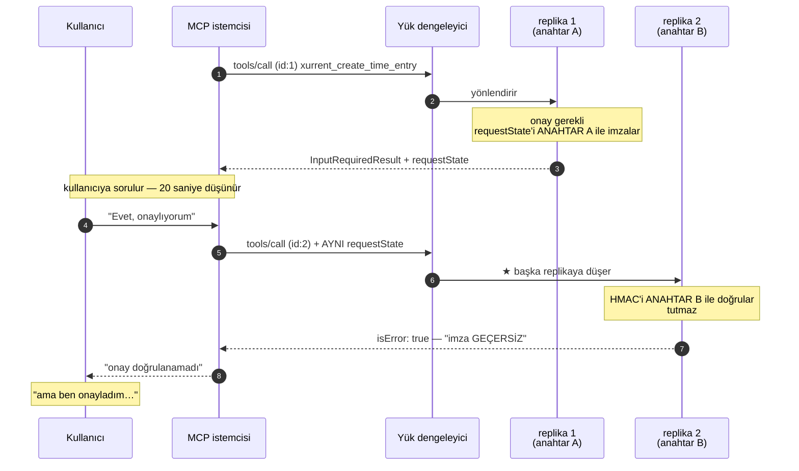

# 19 — Dağıtım (IaC taslağı)

> **Tez:** Bu projeyi dağıtmanın zor kısmı Terraform yazmak değil. Zor kısmı,
> MCP `2026-07-28`'in "stateless" vaadinin **hangi anlamda doğru olduğunu**
> anlamak. Sunucu state tutmuyor — ama state **yok olmuyor**, imzalanıp
> istemciye emanet ediliyor. O imzanın anahtarı replikalar arasında
> paylaşılmazsa onay akışı **sessizce** kırılır: hata yok, log yok, sadece
> "onayladım ama yazılmadı" diyen bir kullanıcı.
>
> Bu belgenin asıl değeri son bölümlerdeki **açık kararlar listesidir.**

---

## 0 — Bu belge ne, ne değil

**Ne:** Çalışan bir IaC iskeleti (`deploy/terraform/`) ve dağıtım öncesi
verilmesi gereken **14 kararın** açık listesi.

**Ne değil:** Bir "dağıtım kılavuzu". Gerçek bir buluta hiçbir şey uygulanmadı —
`apply` yok, `init` bile yok. Uydurma hesap, abonelik ya da kaynak adı
kullanılmadı; hepsi değişken olarak bırakıldı.

**Kim karar verir:** Siz. Bu belge seçenekleri ve her seçeneğin bedelini yazar,
taslağın hangi varsayılanı seçtiğini söyler, ama seçimi size bırakır.

---

## 1 — ★ Dağıtım önkoşulları: üç engel

Terraform'a bakmadan önce şunlar bilinmeli. Üçü de **ölçüldü**, varsayım değil.

### 1.1 Python ve C# sunucuları konteynerde çalışmaz

Her iki HTTP taşıyıcısı da **loopback'e** bağlanıyor:

| Dil | Dosya | Bağlanma |
|---|---|---|
| TypeScript | `servers/typescript/src/mcp/http.ts:161` | `http.listen(port)` → **tüm arayüzler** ✅ |
| Python | `servers/python/src/xurrent_mcp/server.py:205` | `host="127.0.0.1"` ❌ |
| C# | `servers/csharp/Agent/WebHost.cs:111` | `UseUrls($"http://localhost:{...}")` ❌ |

Loopback'e bağlanan bir süreç konteyner **dışından** erişilemez — konteynerin
loopback'i kendisine aittir. Yerelde bu hiç fark edilmez, çünkü yerelde istemci
de aynı makinededir.

★ Bu, dersin *"MCP bir protokoldür, dil bir detaydır"* tezine bir istisna değil;
tezin **taşıyıcı seviyesinde de** sınanması gerektiğinin kanıtı. **Sözleşme
aynı, dağıtılabilirlik değil.**

**Bu bir yamayla çözüldü, kodla değil.** `deploy/docker/Dockerfile.python` ve
`.csharp`, uygulamayı `deploy/docker/bin/loopback-kopru.sh` ile sarıyor:

```
dış dünya ──▶ 0.0.0.0:8788 (socat) ──▶ 127.0.0.1:18788 (uygulama)
```

Köprü, dışa açık portu hangi değişkenin taşıdığını `KOPRU_PORT_DEGISKENI`'nden
öğrenir (varsayılan `MCP_HTTP_PORT`; web modunda **`WEB_PORT` olmalı**).

> ★ **Terraform bu sözleşmeyi karşılamak zorunda.** `modules/mcp-service/main.tf`
> `KOPRU_PORT_DEGISKENI`'ni `server_mode`'a göre ayarlar. Ayarlamasaydı, `web`
> modunda socat hiçbir şeyin dinlemediği bir iç porta bağlanır ve servis
> *"ayakta ama cevapsız"* olurdu — yine **sessiz** bir kırılma.

Kalıcı düzeltme her sunucuya bir dinleme-adresi değişkeni eklemektir
(örn. `MCP_HTTP_HOST=0.0.0.0`). Ölçülmüş bir ayrıntı: C#'ta `ASPNETCORE_URLS`
**yetmez** — kodda çağrılan `UseUrls()` yapılandırmadan sonra yazdığı için kazanır.
Bkz. **K1**.

### 1.2 MCP HTTP taşıyıcısında kimlik doğrulama yok

Üç dilin HTTP taşıyıcısında da `Authorization`/`Bearer`/`401` işleyen tek satır
yok. Endpoint'i herkese açmak, **Xurrent hesabınıza yazma yetkisi olan** bir ucu
internete açmaktır.

Onay akışı bunu kurtarmaz: onay bir **kullanıcıyı** hedefler, kimlik
doğrulamasız bir uçta "kullanıcı" diye bir kavram yoktur. Bkz. **K4**.

### 1.3 Sağlık ucu yok

MCP HTTP taşıyıcısında `/healthz` ya da `/api/health` **yoktur**. Bilinen yollar
yalnızca `/mcp`, `/mcp/v1`, `/mcp/v2`'dir; diğer her yol 404 döner
(`servers/typescript/src/mcp/http.ts:133-145`). Üstelik `MCP_PROTOCOL=both`
iken `/mcp`'nin **kendisi de** 404'tür (aynı dosya, satır 131) — bu kasıtlı bir
404'tür ve sağlıklı bir sunucuyu ölü gösterir.

Bu yüzden iskelet **TCP sondası** kullanıyor. Bkz. **K11**.

★ **İmajdaki `HEALTHCHECK` bunu çözmez.** `deploy/docker/Dockerfile.*` içinde
gerçek bir JSON-RPC yoklaması var (`bin/saglik-kontrol.sh`) ve iyi tasarlanmış —
hatta Python için `server/discover` yerine `initialize` yokluyor, çünkü Python'un
HTTP yolu `server/discover`'a `-32601` diyor. Ama **Cloud Run Docker
`HEALTHCHECK` talimatını yok sayar**; kendi sondalarını kullanır ve bunlar
yalnızca `http_get`, `tcp_socket` ve `grpc`'dir — **exec sondası yoktur.**
Kubernetes ya da ECS'e giderseniz o betik `exec` sondası olarak **doğrudan
kullanılabilir**; Cloud Run'da kullanılamaz.

> Yollar da dile göre değişiyor: C# `app.MapMcp()` ile **kök yolu** (`/`)
> yayımlıyor (`servers/csharp/Agent/WebHost.cs:117`), TypeScript ve Python ise
> `/mcp`. Terraform'un `mcp_endpoint` çıktısı TypeScript düzenini varsayar.

---

## 2 — Mimari



Üç şey bilerek bu şekilde:

1. **Sır deposu ile replikalar arasındaki oklar aynı kutudan çıkıyor.** Tek
   sır sürümü, N replika. Bu diyagramın tek önemli detayı budur.
2. **Yük dengeleyicide sticky session yok** — ve bu doğru, ama yalnızca 1'inci
   madde sağlandığı için. Bkz. § 3.5.
3. **İmajın içinde sır yok.** İmaj bir yapı çıktısıdır, sırlar çalışma anında
   sır deposundan bağlanır.

---

## 3 — ★ `requestState` ve çok replikalılık

### 3.1 Mekanizma — bir hatırlatma

MCP `2026-07-28`'de sunucu kullanıcıya soru **soramaz**; "eksik bilgi var" diye
bir **sonuç döner** ve isteği sonlandırır (MRTR). Onay bağlamını bellekte
tutamayacağı için `requestState` adlı imzalı bir blob'a kodlar ve **istemciye
emanet eder**. İstemci ikinci istekte onu geri getirir.

Spec bu alanı açıkça **"saldırgan kontrolündeki girdi"** sayar; bu yüzden
HMAC-SHA256 ile imzalanır (`contract/protocol.md § requestState bir güvenlik
sınırıdır`).

İmza anahtarı `XURRENT_STATE_SECRET`'tir. Ve şu satır her şeyi belirler
(`servers/typescript/src/core/confirm.ts:63-73`):

```ts
function keyFor(cfg: AppConfig): Buffer {
  if (cfg.stateSecret) return Buffer.from(cfg.stateSecret, "utf8");
  if (!processKey) {
    processKey = randomBytes(32);   // ← anahtar SÜRECE ÖZEL
```

Tek süreçte bu **doğru** davranıştır: sunucu yeniden başlayınca bekleyen onaylar
düşer, "stateless sunucunun unutması" beklenir. Üç dilin dokümantasyonu da bunu
*istenen davranış* diye yazar — ve haklıdır, **tek süreç için.**

### 3.2 Kırılma senaryosu — adım adım

Aynı davranış, çok replikalı bir HTTP dağıtımında şuna dönüşür:



Adım 8 kritik: **ikinci isteğin ilkiyle aynı replikaya düşmesi için hiçbir
sebep yoktur.** MRTR'nin ikinci isteği bağımsız bir istektir — yeni bir JSON-RPC
`id` ile gelir, yeni bir TCP bağlantısı kullanabilir, dakikalar sonra gelebilir.
Yük dengeleyici onu boştaki herhangi bir replikaya verir.

### 3.3 Neden hiçbir logda görünmez

Bu, hatanın kendisinden daha kötü olan kısmı.

| Nerede bakarsınız | Ne görürsünüz |
|---|---|
| Uygulama logu | `requestState imzası GEÇERSİZ` — ama **doğru** bir güvenlik reddi gibi görünür |
| Platform metrikleri | **200 OK.** MCP hataları `isError: true` ile *sonuç içinde* döner |
| Hata telemetrisi | Hiçbir şey. İstisna fırlatılmadı |
| Xurrent | Hiçbir şey. Yazma zaten yapılmadı |

Reddin **doğru** bir red mi yoksa yanlış yapılandırma mı olduğunu ayırt eden bir
işaret yok. Sistem tam olarak tasarlandığı gibi davranıyor — sadece yanlış bir
varsayımla yapılandırılmış. Ve fail-closed olduğu için **veri bozulmuyor**;
yalnızca özellik sessizce ölüyor.

Tek erken uyarı, süreç başındaki şu `warn` satırıdır
(`servers/typescript/src/core/confirm.ts:67`):

> `XURRENT_STATE_SECRET boş — requestState anahtarı süreç başında rastgele üretildi.`

Tek süreçte bu bilgilendirmedir. N replikada **bir arızadır** — ama metni aynı
kaldığı için kimse fark etmez.

### 3.4 Çözüm ve ★ sabit sırrın bedeli

Çözüm basit: **anahtar paylaşılır.** Terraform onu `random_password` ile üretir,
sır deposuna yazar ve tüm replikalara aynı referansı verir
(`deploy/terraform/modules/mcp-service/main.tf`). Üretim bilerek
**platform-bağımsız** modüldedir: kısıt MCP'den gelir, buluttan değil.

Ama sabit anahtarın **bir bedeli var** ve bunu yazmayan her belge eksiktir.

Tek kullanımlık `nonce` seti **süreç içindedir**
(`servers/typescript/src/core/confirm.ts:76`):

```ts
const usedNonces = new Set<string>();
```

Karşılaştırma:

| | Anahtar süreç-rastgele (bugün, tek süreç) | Anahtar sabit + paylaşılan (dağıtım) |
|---|---|---|
| Çok replika | ❌ akış kırılır | ✅ çalışır |
| Sticky session | gerekir (ve yetmez) | **gerekmez** |
| Süreç yeniden başlar | eski state'ler **kriptografik olarak ölür** | eski state'ler **hâlâ geçerli** |
| Kullanılmış state tekrar oynatılırsa | nonce seti yakalar | ★ **yeniden başlamadan sonra yakalamaz** |

Yani anahtarı sabitlemek, "yeniden başlatma her şeyi geçersiz kılar" güvencesini
**feda eder**. Sıfıra ölçeklenen bir kurulumda (`min_replicas = 0`) süreç sık sık
ölüp doğar; her doğuşta nonce seti boşalır ve kullanılmış bir `requestState`,
TTL'i dolana kadar **tekrar oynatılabilir** hâle gelir.

Kalan savunmalar: `exp` (TTL), `principal`, `fingerprint`. Yani tekrar oynatma
**aynı kullanıcının aynı çağrısıyla** sınırlıdır — çift kayıt riski, çapraz
kullanıcı riski değil. Ama sıfır değildir.

> **Pratik sonuç:** `state_ttl_seconds`'ı küçük tutun (varsayılan 300) ve
> `min_replicas = 0`'ın bu maliyeti olduğunu bilerek seçin. Bkz. **K5**.
>
> Gerçek çözüm paylaşılan bir nonce deposudur (Redis/Firestore) — ama bu,
> "stateless sunucu"ya bir state bileşeni eklemektir ve **ders açısından tam da
> tartışılması gereken şeydir**: stateless protokol, stateless *dağıtım*
> garanti etmez.

### 3.5 Sticky session neden gerekmez

`2026-07-28` stateless olduğu için ikinci isteğin aynı replikaya düşmesi
**gerekmez** — Terraform'da `session_affinity = false` açıkça yazılıdır.

★ Ama bu cümle **yalnızca sır paylaşıldığı için doğrudur.** Anahtar replika
başına rastgele olsaydı, sticky session bir "çözüm" gibi görünürdü:

- çoğu istek çalışırdı (aynı replikaya düşerse),
- replika ölünce ya da ölçek değişince **rastgele** kırılırdı,
- ve hata *yük dengeleyicinin* suçu gibi görünürdü.

Yani sticky session burada bir çözüm değil, **teşhisi zorlaştıran bir yamadır**.
İkisini birlikte anlatmak şart: *sticky gerekmez* ve *sır paylaşılmalı* aynı
madalyonun iki yüzüdür.

---

## 4 — Üç sır, üç farklı yaşam döngüsü

Üçünü aynı kutuya koymak en yaygın hatadır. Yaşam döngüleri farklıdır:

| | `XURRENT_TOKEN` | `GEMINI_API_KEY` | `XURRENT_STATE_SECRET` |
|---|---|---|---|
| Kaynağı | Xurrent (insan üretir) | Google (insan üretir) | ★ **Terraform üretir** |
| Terraform görür mü | **hayır** | **hayır** | evet (üretti) |
| Terraform state'te | yok | yok | ★ **düz metin** |
| Ne zaman gerekir | `xurrent_mode = "live"` | `server_mode = "web"` | **her zaman** |
| Rotasyon | Xurrent'ta iptal + yeni sürüm | Google'da iptal + yeni sürüm | `-replace` |
| Rotasyonun etkisi | anında kesinti | anında kesinti | uçuştaki onaylar düşer (≤ TTL) |
| Replikalar arası | aynı olmalı | aynı olmalı | ★ **aynı OLMAK ZORUNDA** |

Son satır önemli: ilk ikisi *pratik olarak* aynıdır (farklı olsa da her replika
Xurrent'a bağlanabilir). Üçüncüsü **doğruluk şartıdır**.

Terraform'un uyguladığı kurallar:

- `tfvars` içinde sır **değeri** yok, yalnızca sır deposundaki **kimlik**
- `extra_env` değişkeni `token|secret|key|password|credential` içeren anahtar
  adlarını `validation` ile **reddeder** — kaza eseri düz metin sızmasın
- `XURRENT_TOKEN`/`GEMINI_API_KEY` için Terraform yalnızca **boş kap** açar;
  değer yoksa dağıtım **başarısız olur** (fail-closed)
- `random_password.state_secret.result` **çıktı olarak verilmez**

> ⚠️ **Terraform state bir sırdır.** `random_password` sonucu state'te düz
> metindir; `sensitive = true` yalnızca ekranı gizler. Bkz. **K7**.

---

## 5 — Sağlık kontrolü ve gözlemlenebilirlik

### 5.1 Sonda: neden TCP

§ 1.3'teki sebeple: HTTP sağlık ucu yok, `/mcp`'ye GET atmak JSON-RPC değildir ve
`both` modunda `/mcp` zaten 404'tür. İskelet `startup_probe` olarak
`tcp_socket` kullanıyor.

TCP sondası **portun açık olduğunu** söyler, **uygulamanın sağlıklı olduğunu**
değil. Node olay döngüsü kilitlenirse port yine açıktır. `GET /healthz`
eklenmesi bunu düzeltir — **K11**.

### 5.2 ★ "stdout yalnızca JSON-RPC" kuralı HTTP'de GEÇERLİ DEĞİL

`servers/typescript/src/util/log.ts:4-7`:

> **KRİTİK KURAL — stdio transport'ta stdout SADECE JSON-RPC içindir.**

Bu kural **stdio'ya özgüdür.** Sebebi protokol değil **taşıyıcıdır**: stdio'da
çerçeveleme stdout üzerinden yapılır, oraya yazılan tek bir `\n` ayrıştırıcıyı
bozar. HTTP taşıyıcısında çerçeveleme TCP/HTTP katmanındadır; stdout serbesttir.

Yani konteynerde **stdout'a yazmak güvenlidir** — ve platformların log
toplayıcıları zaten stdout/stderr okur. Repo yine de her şeyi `stderr`'e yazar
(`log.ts:49`), ki tek bir kod yolu iki taşıyıcıda da doğru olsun. Bu iyi bir
karar; ama dağıtımda bir yan etkisi var:

> **Cloud Run'da yapılandırılmamış `stderr` çıktısı `ERROR` şiddetiyle
> etiketlenir.** Sonuç: tüm `INFO` loglarınız hata paneline düşer, gerçek hatalar
> gürültüye gömülür — yani § 3.3'teki "logda görünmez" sorununu **ağırlaştırır**.

Bkz. **K12**.

### 5.3 Sır maskeleme

Logger `token|secret|key` kalıplı anahtarları `***` ile maskeler ve
`Bearer ...` değerlerini kırpar (`log.ts:25-35`). Bu, dağıtımda gerçekten önemli
hâle gelir: yerelde logu siz görürsünüz, bulutta **log toplayıcıya erişen herkes**.

---

## 6 — ★ AÇIK KARARLAR

Bu belgenin en değerli bölümü. Her madde: seçenekler, artı/eksi, taslağın
seçimi. **Taslağın seçimi bir karar değildir** — sadece iskeletin derlenebilmesi
için konmuş bir varsayılandır.

> ⚠️ **Numaralandırma çakışması — okurken dikkat.** Bu repoda üç ayrı karar
> defteri var ve üçü de `K` öneki kullanıyor:
>
> | Defter | Konu | Kimlikler |
> |---|---|---|
> | **bu belge** | **dağıtım / IaC** | `K1`…`K14` |
> | `.github/KARARLAR-CICD.md` | CI/CD, imaj yayını, güvenlik taraması | `K-1`…`K-14` |
> | `deploy/docker/KARARLAR.md` | konteyner imajları | `K-01`… |
>
> Tek fark tire. **Birleştirilmeleri gerekiyor** — bu da bir karar maddesidir ve
> bilerek açık bırakıldı; hangi defterin kimliği taşıyacağı sizin seçiminiz.

---

### K1 — Hangi dil dağıtılır? Ve loopback yaması kalıcı mı?

Repo'nun tezi "üçü denktir". Dağıtım bunu **sınıyor**.

| Seçenek | Artı | Eksi |
|---|---|---|
| **TypeScript** | Yamasız çalışan **tek** dil. En küçük imaj | v2 için ayrı bir paket kullanıyor (`@modelcontextprotocol/server`) |
| Python | Ölçüldü: hem v1 hem v2 konuşuyor | ★ Loopback köprüsü gerekir (socat, fazladan süreç) |
| C# | Ölçüldü: hem v1 hem v2. Tek örnekte iki yol | ★ Köprü gerekir. Ayrıca yolu `/`, diğerleri `/mcp` |
| **Üçü de** | Tezi gerçekten kanıtlar: aynı sözleşme, üç konteyner, aynı istemci | 3× maliyet, 3× imaj, 3× sır bağlama |

**Taslağın seçimi:** yok — `image` değişkeninin varsayılanı **yoktur**.

**İç içe geçmiş ikinci karar: köprü kalıcı mı?**

| Seçenek | Artı | Eksi |
|---|---|---|
| Köprüyü koru | Kod değişmez; bugün çalışıyor | Fazladan süreç · konteynerdeki port ile koddaki port farklı · yeni bir sessiz kırılma yüzeyi (`KOPRU_PORT_DEGISKENI`) |
| **Koda dinleme-adresi değişkeni ekle** | Yama ölür; üç dil gerçekten denk olur | Üç dilde küçük bir değişiklik + uyum testine bir madde |

**Öneri:** Köprüyü **geçici** sayın. `MCP_HTTP_HOST`/`WEB_HOST` değişkenleri
eklenince Dockerfile'lar sadeleşir ve *"aynı sözleşme, üç konteyner"* gösterisi
açıklama gerektirmeden çalışır. C# için not: `ASPNETCORE_URLS` **yetmez**,
`UseUrls()` çağrısının kendisi değişmeli.

---

### K2 — Hedef platform

| Seçenek | Artı | Eksi |
|---|---|---|
| **GCP Cloud Run** (taslağın seçimi) | Sıfıra ölçeklenir · sır bağlama yerleşik · tek kaynakta servis+ölçek+sonda · Gemini zaten Google | Google'a bağımlılık; `google` sağlayıcısı büyük |
| Azure Container Apps | KEDA ile zengin ölçekleme · Key Vault · kurumsal AD entegrasyonu | Daha çok kaynak (ortam + servis + kimlik); sıfıra ölçeklenme daha kısıtlı |
| AWS App Runner | En az kavram | Sıfıra ölçeklenmez (bekleyen örnek ücretli) · sır bağlama daha dolaylı |
| ECS/Fargate · Kubernetes | Tam kontrol | ★ Bu iskeletin 3-4 katı IaC. Ders için orantısız |
| Tek VM + systemd | En ucuz, en anlaşılır | ★ Çok replika yok → bu belgenin ana konusu **hiç ortaya çıkmaz** |

**Neden Cloud Run seçildi:** üç zorunlu içeriği (konteyner + sır bağlama +
min/max replika) **tek kaynakta** ifade ediyor, böylece asıl anlatılmak istenen
şey — paylaşılan sır — IaC gürültüsüne gömülmüyor.

**Nasıl değiştirilir:** `modules/platform-*` altına ikinci bir modül yazın ve
`modules/mcp-service/main.tf`'teki dispatch'e ekleyin. **Arayüz değişmez** —
ayrımın bütün amacı bu.

---

### K3 — Varsayılan `XURRENT_MODE`: mock demo mu, live mi?

| Seçenek | Artı | Eksi |
|---|---|---|
| **`mock`** (taslağın seçimi) | Token gerekmez · hesap gerekmez · yanlışlıkla canlıya yazma **imkânsız** · demo her zaman aynı sayıları verir | "Gerçek" değil; live yolundaki hatalar dağıtımda ortaya çıkmaz |
| `live` + `dry_run=1` | Kimlik doğrulama ve sorgular **gerçekten** sınanır, hiçbir kayıt yazılmadan | Token gerekir; `DOĞRULANMALI` maddeleri hâlâ açık |
| `live` + `dry_run=0` | Tam gerçek | ★ Xurrent bir *system of record*'dur; yanlış zaman girişi **faturalamaya** kadar gider |

**Öneri:** `mock` ile başlayın. Live'a geçiş **iki adımlı** olsun:
`live`+`dry_run=1` ile bir hafta, çıktı incelendikten sonra `dry_run=0`.

Terraform bunu destekliyor: `xurrent_dry_run` varsayılanı **`true`**, ve
`confirm_policy = "open"` ile `xurrent_mode = "live"` birlikte verilirse
`validation` **apply'ı reddeder** — onaysız canlı yazma bir yapılandırma hatasıyla
oluşamaz.

---

### K4 — ★★★ Kimlik doğrulama

**En kritik karar.** § 1.2: MCP HTTP taşıyıcısında kimlik doğrulama **yok**.

| Seçenek | Artı | Eksi |
|---|---|---|
| **Platform IAM** (taslağın seçimi: `allow_unauthenticated = false`) | Kod değişmez · yetkilendirme buluta devredilir | ★ MCP istemcileri IAM token'ı üretmez; Claude Code doğrudan bağlanamaz. Proxy gerekir |
| İç ingress + VPC/tünel | Endpoint internete hiç çıkmaz | Kurulum ağır; uzaktan çalışan istemci için VPN şart |
| Kodda bearer token kontrolü | İstemciler bunu **yapabilir** (header) | ★ Kod yok — yazılması gerekir. Token yönetimi yeni bir sorun |
| MCP OAuth (spec'in yolu) | Standart, doğru cevap | Bu repoda hiç yok; ciddi iş |
| `allow_unauthenticated = true` | "Çalışıyor" | ★★★ **Xurrent'a yazabilen açık uç.** Yapmayın |

**Öneri:** Ders demosu için **hiç dağıtmayın** — stdio yeterli (§ 8). Gerçekten
gerekiyorsa: iç ingress + kısa ömürlü bir tünel. `allow_unauthenticated = true`
yalnızca `xurrent_mode = "mock"` iken düşünülebilir, ve o zaman bile açık uç bir
LLM'in tool çağırabildiği bir yüzeydir.

---

### K5 — `min_replicas`: sıfıra ölçeklenme

| Seçenek | Artı | Eksi |
|---|---|---|
| **`0`** (taslağın seçimi) | Boşta maliyet ~sıfır · ders reposu için doğru | ★ Soğuk başlangıç gecikmesi · **nonce seti kaybolur** (§ 3.4) |
| `1` | Soğuk başlangıç yok · nonce seti daha uzun yaşar | Sürekli ücretlendirilen bir örnek |
| `≥ 2` | Bakım sırasında kesinti yok | Maliyet × N · ★ paylaşılan sır **şart** (Terraform sağlıyor) |

**Not:** `max_replicas > 1` her durumda paylaşılan sırrı zorunlu kılar; iskelet
bunu zaten garanti eder. Asıl incelik `min_replicas = 0`'ın **güvenlik**
maliyetidir, maliyet değil.

---

### K6 — Sır deposu ve `XURRENT_TOKEN`'ı kim yazar?

| Seçenek | Artı | Eksi |
|---|---|---|
| **Terraform kabı açar, insan değeri yazar** (taslağın seçimi) | Sır Terraform state'ine **hiç girmez** | Apply sonrası elle bir adım (`secrets_to_fill` çıktısı hatırlatır) |
| Terraform değeri de yazar (`var` ile) | Tek adım | ★ Sır tfvars'a ve state'e **düz metin** girer. Kabul edilemez |
| Sır tamamen Terraform dışında, `data` ile okunur | Terraform hiç dokunmaz | ★ `data` **okur** → yine state'e düşer |
| Harici sır yöneticisi (Vault, ESO) | Rotasyon otomatik, denetim izi | Yeni bir bileşen; bu ölçek için orantısız |

**Not:** `XURRENT_STATE_SECRET` bu tablonun dışındadır — onu Terraform
**üretmek zorunda**, çünkü paylaşılan olması gereken tek şey odur ve insanın
üretip üç yere kopyalaması hataya en açık yoldur.

---

### K7 — Terraform state backend

★ State, üretilen `XURRENT_STATE_SECRET`'i **düz metin** tutar.

| Seçenek | Artı | Eksi |
|---|---|---|
| Yerel state | Kurulum yok | ★ Sır laptop'ta · yedek yok · kilit yok · iki kişi çalışamaz |
| **Uzak state** (GCS/S3/Azure) | Şifreli, sürümlü, kilitli, erişimi kısıtlı | Yumurta-tavuk: kovayı kim oluşturur? |
| Terraform Cloud / Enterprise | Kilit + denetim + politika hazır | Dış bağımlılık, hesap |

**Taslağın seçimi:** yok. `envs/dev/backend.tf.example` yorumlu bırakıldı,
uydurma kova adı **kullanılmadı**. `.gitignore` `*.tfstate`'i kapsıyor.

**Öneri:** Bir kişiden fazla dokunacaksa uzak state **zorunludur** — kilit
olmadan eşzamanlı iki `apply` state'i bozar.

---

### K8 — İmaj hattı · **büyük ölçüde KARARA BAĞLANDI**

Bu madde yazıldığında repoda Dockerfile yoktu; **artık var**
(`deploy/docker/Dockerfile.<dil>`, derleme bağlamı **depo kökü** — zorunlu,
çünkü üç sunucu da `contract/` ve `fixtures/` okur). Yayın hattı için
`.github/KARARLAR-CICD.md` → **K-1** ve **K-3**'e bakın.

IaC tarafında geriye tek bir şey kalıyor:

| Karar | Seçenekler |
|---|---|
| Terraform'a ne geçilir | `:latest` ❌ · `:<git-sha>` ✅ · **`@sha256:` ✅✅** |
| Kaç servis dağıtılır | 1 (yalnız TS) · 3 (üç dil, tezin gösterisi) — bkz. K1 |

**Öneri:** Terraform'a **digest** geçin. `:latest`, *"aynı Terraform, farklı
sonuç"* sınıfı hataların klasik kaynağıdır ve bu belgedeki bütün sessiz
kırılmalarla aynı aileden gelir.

> ★ **Adlandırma tutarsızlığı bilinen bir açık uç:** `deploy/docker/compose.yaml`
> yerel imajları `xurrent-mcp-typescript:draft` diye adlandırıyor, GHCR'ye
> itilenler ise `xurrent-mcp-ts|py|cs`. Terraform'a hangisini geçeceğiniz
> netleşmeli. (`.github/KARARLAR-CICD.md` → K-1 sonu)

---

### K9 — Bölge / veri ikameti

Servis Xurrent'a bağlanır ve **zaman girişi verisi** taşır — yani kişi + iş
kaydı. Bölge seçimi bir uyum kararıdır.

- Xurrent bölgeleri: Global (varsayılan), `au`, `uk`, `ch`, `us`
- ⚠️ **`eu` diye bir bölge yoktur.** `graphql.eu.xurrent.com` wildcard DNS ile
  çözülür ama TLS hatası verir. **Global zaten Avrupa'dır.**
- Konteyner bölgesi Xurrent bölgesine **yakın** olmalı: her tool çağrısı bir
  ya da iki GraphQL turu demektir

**Taslağın seçimi:** yok — `gcp_region` zorunlu, varsayılansız.

---

### K10 — Takvim sağlayıcısı

★ `google` ve `graph` dağıtımda **çalışmaz** ve bu sessiz bir hatadır.

Google akışı OAuth token'ını `~/.xurrent-mcp/google-token.json` dosyasına yazar
(README § Takvim sağlayıcıları). Konteyner dosya sistemi **efemerdir** ve
replikalar arasında **paylaşılmaz**: token her yeniden başlatmada kaybolur,
yenilenen token yazılamaz.

| Seçenek | Artı | Eksi |
|---|---|---|
| **`mock`** (taslağın seçimi) | Çalışır, deterministik | Gerçek takvim yok |
| `ics` (yayımlanmış URL) | Gerçek takvim, durum tutmaz | URL'in kendisi bir sırdır (tahmin edilemez bağlantı) |
| `google`/`graph` | Gerçek entegrasyon | ★ Token'ı sır deposuna taşımak gerekir — **kod değişikliği** |

Terraform bunu `validation` ile zorluyor: `google`/`graph` verilirse apply
**reddedilir**, sebebini açıklayarak.

---

### K11 — Sağlık ucu eklensin mi?

| Seçenek | Artı | Eksi |
|---|---|---|
| **TCP sondası** (taslağın seçimi) | Kod değişmez · köprü ölürse yakalar (socat dinlemiyorsa port kapalıdır) | Yalnızca "port açık" der; kilitlenmiş süreci sağlıklı sayar |
| `GET /healthz` ekle | Gerçek sağlık · üç dilde **10'ar satır** · MCP spec'ine aykırı değil (ayrı yol) | Üç dilde de yazılmalı; uyum testine bir madde daha |
| İmajdaki `HEALTHCHECK`'e güven | Zaten yazılmış ve iyi | ★ **Cloud Run onu yok sayar.** Yalnızca Docker/compose/K8s(exec) ortamlarında işe yarar |
| `/mcp`'ye HTTP sondası | Yeni kod yok | ★ İki türlü yanlış: GET JSON-RPC değil, ve `both` modunda kasıtlı 404 |

**Öneri:** `/healthz` ekleyin. Mod, protokol ve sır **varlığını** (değerini
değil) raporlasın; § 3.3'teki teşhis boşluğunu da kısmen kapatır — örneğin
`stateSecretSource: "env" | "random"` alanı, yanlış yapılandırmayı **görünür**
kılar.

---

### K12 — Log biçimi

| Seçenek | Artı | Eksi |
|---|---|---|
| **Bugünkü hâli** (stderr, düz metin) | Kod değişmez, stdio ile aynı yol | ★ Cloud Run'da hepsi `ERROR` şiddetinde görünür |
| Yapısal JSON + `severity` alanı | Doğru şiddet · alan bazlı sorgu · sır maskesi korunur | Küçük bir logger değişikliği (üç dilde) |
| stdio → stderr, HTTP → stdout | Platform beklentisine tam uyum | İki kod yolu; "stdout kuralı"nı bulanıklaştırır |

**Öneri:** Yapısal JSON. Ders açısından da güzel bir nokta: *"stdout yalnızca
JSON-RPC" kuralı taşıyıcıya özgüdür, protokole değil.*

---

### K13 — `MCP_PROTOCOL` ve yol düzeni

| Seçenek | Artı | Eksi |
|---|---|---|
| **`2026-07-28`** (taslağın seçimi) | Güncel spec · `/mcp` kısayolu çalışır | Eski istemciler bağlanamaz |
| `2025-11-25` | Yaygın istemci desteği | Kaldırılmış deseni yayına almak |
| `both` | ★ İki revizyonu **yan yana** göstermek — dersin ana konusu | `/mcp` **404** olur; istemcilere `/mcp/v2` verilmeli |

**Not:** Yol düzeni **dile göre değişiyor** (§ 1.3 sonu). Üç dili birden
dağıtacaksanız önce yolları eşitleyin, yoksa `mcp_endpoint` çıktısı yalnızca
TypeScript için doğru olur.

---

### K14 — CD: `apply`'ı kim koşar?

Bu repoda CI var, **CD yok.**

| Seçenek | Artı | Eksi |
|---|---|---|
| Elle `apply` | Basit, denetlenebilir, ders için yeterli | Tekrarlanabilir değil; "kimin makinesinde" sorusu |
| CI'da plan, elle onaylı apply | ★ İyi denge: plan görünür, apply kasıtlı | Ortam sırları CI'ya taşınır |
| Tam otomatik CD | Hızlı | ★ Bulut kimliğini CI'ya vermek; ders reposu için orantısız risk |

**Öneri:** PR'da `plan` (çıktı yorum olarak), `main`'de **elle onaylı** apply.
Mevcut `ci.yml` **silinmeden** ikinci bir iş akışı olarak eklensin.

---

## 7 — Maliyet

Kesin rakam vermiyorum; fiyatlar değişir ve uydurma sayı bu belgenin işine gelmez.
Büyüklük mertebeleri şöyle:

| Kalem | Sürücü | Not |
|---|---|---|
| Konteyner çalışma süresi | ★ **`min_replicas`** | `0` → boşta ücret yok. `1` → 7/24 ücret. Baskın kalem budur |
| İstek | çağrı sayısı | Ders demosunda ihmal edilebilir |
| Sır saklama | sürüm sayısı × ay | 2-3 sır; çok küçük |
| Sır okuma | konteyner **başlangıcı** başına | ★ Sıfıra ölçeklenip sık doğmak bunu artırır |
| İmaj deposu | imaj boyutu × ay | 3 dil = 3 imaj |
| Çıkış trafiği | Xurrent + Gemini çağrıları | Küçük ama sıfır değil |
| Log saklama | ★ **log hacmi** | K12 çözülmezse hepsi `ERROR`; saklama politikası pahalıya gidebilir |

**En büyük tuzak maliyet değil, unutmaktır:** ders bitince ayakta kalan bir
`min_replicas = 1` servisi aylarca sessizce fatura üretir. `deletion_protection`
bilerek `false` bırakıldı ki `terraform destroy` ders sonunda çalışsın.

---

## 8 — Bunu gerçekten dağıtmalı mıyım?

**Muhtemelen hayır.** Dürüst cevap bu.

Bu bir **ders reposudur**. MCP sunucusunun birincil çalışma biçimi **stdio**'dur:
istemci süreci başlatır, tek kullanıcı, tek süreç, sır tek bellekte. Bu senaryoda
bu belgedeki hiçbir sorun **yoktur** — ne çok replika, ne paylaşılan sır, ne
kimlik doğrulama, ne fatura.

Uzak dağıtımın gerçekten gerektiği durumlar dar:

- MCP sunucusuna **birden çok kişi** aynı anda bağlanacaksa
- İstemci ortamı **süreç başlatamıyorsa** (tarayıcı tabanlı bir host)
- Sunucunun kullanıcı makinesinde bulunmayan bir kaynağa (VPN arkası) erişmesi gerekiyorsa

Hiçbiri bu ders için geçerli değil.

**O hâlde bu klasör neden var?**

Çünkü *"MCP 2026-07-28 stateless'tır"* cümlesinin ne anlama geldiğini gerçekten
anlamanın en iyi yolu, onu çok replikalı bir dağıtıma koymayı **denemektir**.
Deneme, cümlenin yarım olduğunu ortaya çıkarır: sunucu state tutmuyor, ama
state'in **imzası** paylaşılan bir sır gerektiriyor.

Bu, IaC'nin dağıtım için değil **anlamak için** yazıldığı bir durumdur. İskelet
gerçek, uygulanabilir ve doğrulanmış olmalı — ama uygulanması gerekmiyor.

> Derste kullanmak için önerim: `terraform plan` çıktısını gösterin, `apply`
> koşmayın. Asıl ders § 3'teki sequence diyagramıdır, faturada değil.

---

## 9 — Doğrulama durumu

★ **Bu iskelet yazılırken makinede `terraform` da `tofu` da kurulu değildi.**
Yani `terraform fmt -check` ve `terraform validate` **çalıştırılamadı.**

Yerine üç katman doğrulandı (`deploy/terraform/dogrula.py`):

| Katman | Ne yapar | Karşılığı |
|---|---|---|
| Ayrıştırma | Gerçek bir HCL2 ayrıştırıcısı (`python-hcl2`) 14 dosyayı da okuyor | `fmt`in söz dizimi kontrolü |
| Biçim | `=` hizası, girinti, sekme, satır sonu boşluğu, dosya sonu | `fmt -check` |
| Anlam | Tanımsız `var.`/`local.`/kaynak atıfları, modül çağrısında bilinmeyen/eksik argüman, olmayan çıktı okuma | `validate`in yakaladığı hataların çoğu |

**Sonuç:** 14 dosya · 1372 satır · 179 hizalama zinciri → **TEMİZ**.

Doğrulayıcının kendisi de **sabotajla sınandı**: tanımsız değişken, bozuk hizalama
ve bilinmeyen modül argümanı üçü de yakalandı. (Bu repoda "denetlediğini sanan ama
denetlemeyen bir test" bir kez yaşandı — tekrarlanmasın.)

**★ Ne doğrulanmadı — ve bu önemli:**

- **Sağlayıcı şema uyumu.** `google_cloud_run_v2_service` gerçekten
  `session_affinity`, `startup_probe.tcp_socket`, `deletion_protection`
  alanlarını kabul ediyor mu — bunu yalnızca sağlayıcı indirilerek doğrulanır.
- Terraform'un tip sistemi, `for_each` bilinirliği, sağlayıcı sürüm çözümü.
- Hiçbir buluta hiçbir şey uygulanmadı.

Yani `TEMIZ` çıktısı **"apply çalışır" demek değildir.** Terraform kurulunca
sırayla şunlar koşulmalı ve **üçü geçmeden `plan` bile koşulmamalı**:

```bash
terraform -chdir=deploy/terraform/envs/dev init -backend=false
terraform fmt -recursive -check deploy/terraform
terraform -chdir=deploy/terraform/envs/dev validate
```

---

## 10 — Sonraki adım

Bu taslak IaC tarafını dolduruyor. Eksik kalan:

1. **Bağlanma düzeltmesi** (K1) — Python ve C# için dinleme adresi
   yapılandırılabilir olsun; loopback köprüsü o zaman silinebilir
2. **`GET /healthz`** (K11) — üç dilde. Sırrın **varlığını** (değerini değil)
   ve `stateSecretSource: "env" | "random"` bilgisini raporlasın: § 3.3'teki
   teşhis boşluğunu kapatan en ucuz şey budur
3. **Karar defterlerinin birleştirilmesi** — üç ayrı `K` numaralandırması var
4. **`terraform validate`** — terraform kurulunca; `dogrula.py` o zaman silinsin
5. **`test-all`'a bir adım**: IaC doğrulaması 17'nci adım olarak eklenebilir —
   IaC de bir doğrulama katmanıdır ve bu repoda katmanlar sayılıyor

Hiçbiri bu görevin yazma izni içinde değildi; hepsi bilinçli olarak açık bırakıldı.

---

| ← Önceki | Sonraki → |
|---|---|
| [18 — CLI](18-cli.md) | — |

> **Numara notu:** Bu bölüm ilk yazıldığında 15 numarasını almıştı; güvenilirlik
> bölümüyle (docs/15) çarpışınca 19'a taşındı. requestState'in diller arası
> taşınabilirliği bu taşımadan sonra çözüldü — bkz. docs/08 **D21**.
